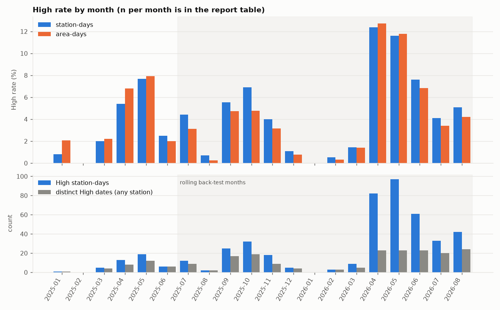
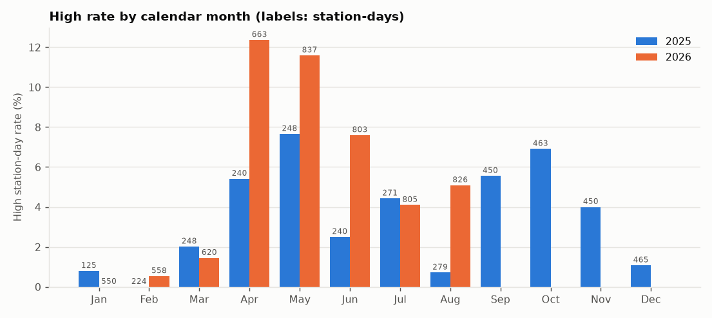
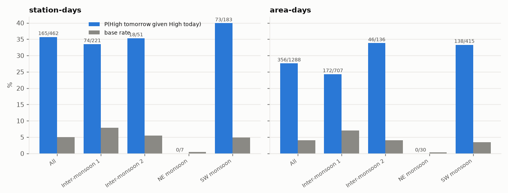
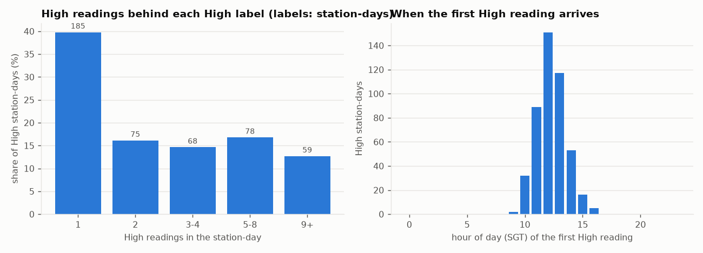
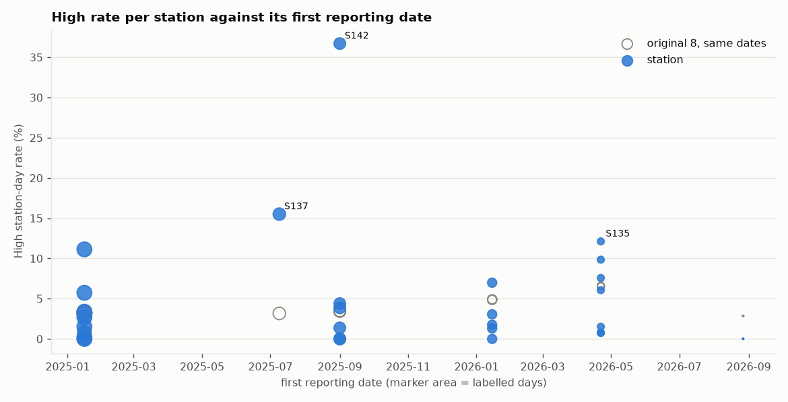
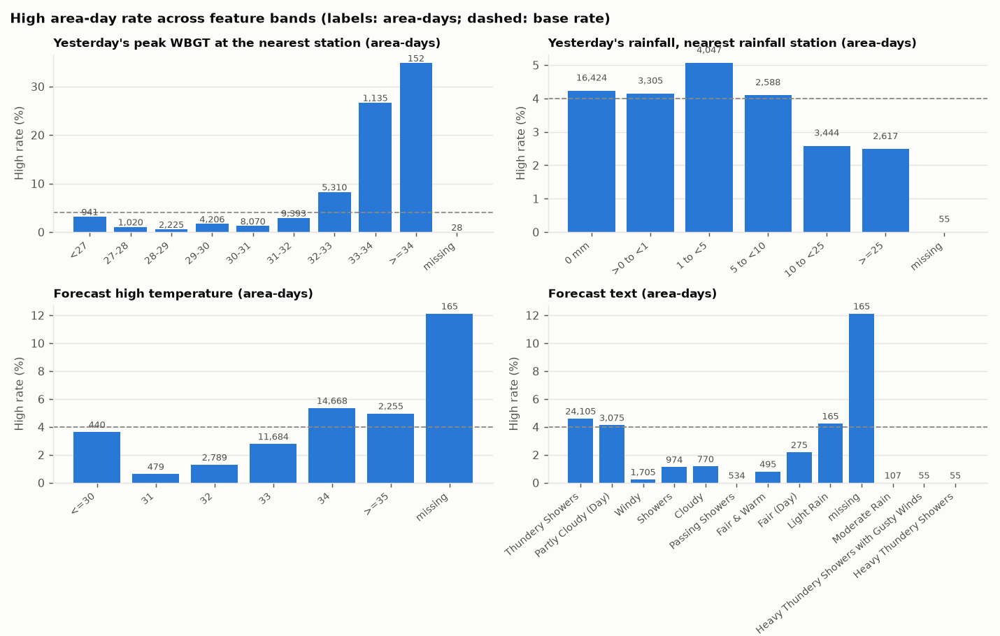
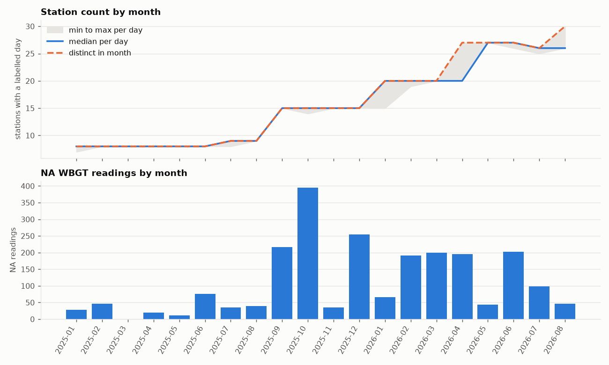

# Targeted EDA before the model

**Analysis window: 2025-01-16 to 2026-08-31 (SGT dates), inclusive.** The script reads nothing from 2026-09-01 to 2026-10-19: every table is filtered to the window at the scan, queries run only on filtered views, and the window audit at the end shows the first and last date of every frame read (asserted inside the window).

Generated 2026-10-22 01:02 SGT by `scripts/analysis/eda.py` at git `917e39a` (script not committed). Numbers are counts from Silver as read in this run. This report states numbers and flags; it does not interpret them or choose features.

## Flags (rule-based; numbers only)

- 8 of 14 back-test months have fewer than 30 High station-days (2025-07 12, 2025-08 2, 2025-09 25, 2025-11 18, 2025-12 5, 2026-01 0, 2026-02 3, 2026-03 9); 1 month(s) with no High date at any station.
- Stations with fewer than 30 labelled days in the window: S131 (5 days from 2026-08-27), S133 (5 days from 2026-08-27), S138 (5 days from 2026-08-27), S910 (5 days from 2026-08-27).
- Stations (60+ labelled days) whose High rate is at least double or at most half the original-8 rate on the same dates: S124 (0.0% vs 3.2%), S128 (11.1% vs 3.2%), S129 (1.5% vs 3.2%), S130 (0.8% vs 3.0%), S132 (0.2% vs 3.2%), S137 (15.5% vs 3.2%), S139 (0.0% vs 3.4%), S140 (0.0% vs 3.4%), S142 (36.7% vs 3.4%), S187 (1.4% vs 3.4%), S149 (0.0% vs 4.9%), S150 (1.3% vs 4.9%), S153 (1.8% vs 4.9%), S146 (0.8% vs 6.6%), S148 (0.8% vs 6.6%), S180 (1.5% vs 6.6%).
- NA WBGT readings in the window: 2,199, against the plan's 2,894. The EDA window is 16 Jan 2025 to 31 Aug 2026 only; the plan's figures run to 19 Oct 2026. This window difference, not an error, explains the gap.
- WBGT short days in the window: 18, against the plan's 21. The EDA window is 16 Jan 2025 to 31 Aug 2026 only; the plan's figures run to 19 Oct 2026. This window difference, not an error, explains the gap.

## Definitions used

- **Station-day:** a row of `silver.station_daily_label` with a label (the highest API `heatStress` of the day: Low, Moderate or High). **High** means that label is High. A High label always stands.
- **Area-day:** planning area x target date, labelled with the label of the area's nearest reporting station on that date (the H10 rule: boundary mp2025, reference point = polygon centroid, a station reports if it has a counted reading in the 7 days before the 00:15 cut-off). The nearest station can change from day to day. Area-days are not independent: 55 areas share 29 stations, so one station-day appears in many area-days and the area-day intervals are too narrow.
- `gold.area_nearest_station_daily` was **not read**; its SQL was re-run on the window-filtered labels (see the script header). Area-days with a target date in the window: 32,560; with a label: 32,480.
- 95% intervals are Wilson intervals. Month and season names follow calendar months (NE monsoon Dec to Feb, Inter-monsoon Mar to May, SW monsoon Jun to Sep, Inter-monsoon Oct to Nov), an approximation of NEA's.
- **Original 8:** S124, S125, S126, S127, S128, S129, S130, S132. Late starters examined in check 5: S142, S137, S135.

## 1. High base rate (per station-day and per area-day), by month and year

Overall: **465 High of 9,365** labelled station-days (5.0%; 4.5% to 5.4%), on 593 dates, 212 of which have a High at any station. **1,297 High of 32,480** labelled area-days (4.0%), 212 High dates. Counting only `usable` station-days (a Low or Moderate label on a low-coverage day is not usable): 465 High of 9,309 (5.0%); 56 labelled station-days are not usable.

### By year

Station-days:

| year | station-days | High station-days | rate | 95% CI |
|---|---|---|---|---|
| 2025 | 3,703 | 138 | 3.7% | 3.2% to 4.4% |
| 2026 | 5,662 | 327 | 5.8% | 5.2% to 6.4% |

Area-days:

| year | area-days | High area-days | rate | 95% CI |
|---|---|---|---|---|
| 2025 | 19,141 | 615 | 3.2% | 3.0% to 3.5% |
| 2026 | 13,339 | 682 | 5.1% | 4.8% to 5.5% |

### By month: station-days

`High dates` = distinct SGT dates with at least one High station-day. The original-8 columns are counts (High/labelled station-days). 2025-01 starts on 16 Jan.

| month | backtest month | dates labelled | station-days | High station-days | rate | 95% CI | High dates (any station) | High station-days (original 8) | High dates (original 8) |
|---|---|---|---|---|---|---|---|---|---|
| 2025-01 |  | 16 | 125 | 1 | 0.8% | 0.1% to 4.4% | 1 | 1/125 | 1 |
| 2025-02 |  | 28 | 224 | 0 | 0.0% | 0.0% to 1.7% | 0 | 0/224 | 0 |
| 2025-03 |  | 31 | 248 | 5 | 2.0% | 0.9% to 4.6% | 4 | 5/248 | 4 |
| 2025-04 |  | 30 | 240 | 13 | 5.4% | 3.2% to 9.0% | 8 | 13/240 | 8 |
| 2025-05 |  | 31 | 248 | 19 | 7.7% | 5.0% to 11.7% | 12 | 19/248 | 12 |
| 2025-06 |  | 30 | 240 | 6 | 2.5% | 1.2% to 5.3% | 6 | 6/240 | 6 |
| 2025-07 | yes | 31 | 271 | 12 | 4.4% | 2.6% to 7.6% | 9 | 8/248 | 7 |
| 2025-08 | yes | 31 | 279 | 2 | 0.7% | 0.2% to 2.6% | 2 | 0/248 | 0 |
| 2025-09 | yes | 30 | 450 | 25 | 5.6% | 3.8% to 8.1% | 17 | 3/240 | 2 |
| 2025-10 | yes | 31 | 463 | 32 | 6.9% | 4.9% to 9.6% | 19 | 3/248 | 3 |
| 2025-11 | yes | 30 | 450 | 18 | 4.0% | 2.5% to 6.2% | 9 | 5/240 | 2 |
| 2025-12 | yes | 31 | 465 | 5 | 1.1% | 0.5% to 2.5% | 4 | 1/248 | 1 |
| 2026-01 | yes | 31 | 550 | 0 | 0.0% | 0.0% to 0.7% | 0 | 0/248 | 0 |
| 2026-02 | yes | 28 | 558 | 3 | 0.5% | 0.2% to 1.6% | 3 | 0/224 | 0 |
| 2026-03 | yes | 31 | 620 | 9 | 1.5% | 0.8% to 2.7% | 5 | 3/248 | 2 |
| 2026-04 | yes | 30 | 663 | 82 | 12.4% | 10.1% to 15.1% | 23 | 26/240 | 19 |
| 2026-05 | yes | 31 | 837 | 97 | 11.6% | 9.6% to 13.9% | 23 | 19/248 | 14 |
| 2026-06 | yes | 30 | 803 | 61 | 7.6% | 6.0% to 9.6% | 23 | 19/234 | 14 |
| 2026-07 | yes | 31 | 805 | 33 | 4.1% | 2.9% to 5.7% | 20 | 7/216 | 7 |
| 2026-08 | yes | 31 | 826 | 42 | 5.1% | 3.8% to 6.8% | 24 | 12/217 | 11 |

### By month: area-days

| month | backtest month | area-days | High area-days | rate | 95% CI | High dates (any area) |
|---|---|---|---|---|---|---|
| 2025-01 |  | 777 | 16 | 2.1% | 1.3% to 3.3% | 1 |
| 2025-02 |  | 1,540 | 0 | 0.0% | 0.0% to 0.2% | 0 |
| 2025-03 |  | 1,705 | 38 | 2.2% | 1.6% to 3.0% | 4 |
| 2025-04 |  | 1,650 | 112 | 6.8% | 5.7% to 8.1% | 8 |
| 2025-05 |  | 1,705 | 135 | 7.9% | 6.7% to 9.3% | 12 |
| 2025-06 |  | 1,650 | 33 | 2.0% | 1.4% to 2.8% | 6 |
| 2025-07 | yes | 1,705 | 53 | 3.1% | 2.4% to 4.0% | 9 |
| 2025-08 | yes | 1,705 | 4 | 0.2% | 0.1% to 0.6% | 2 |
| 2025-09 | yes | 1,650 | 78 | 4.7% | 3.8% to 5.9% | 17 |
| 2025-10 | yes | 1,699 | 81 | 4.8% | 3.9% to 5.9% | 19 |
| 2025-11 | yes | 1,650 | 52 | 3.2% | 2.4% to 4.1% | 9 |
| 2025-12 | yes | 1,705 | 13 | 0.8% | 0.4% to 1.3% | 4 |
| 2026-01 | yes | 1,705 | 0 | 0.0% | 0.0% to 0.2% | 0 |
| 2026-02 | yes | 1,534 | 5 | 0.3% | 0.1% to 0.8% | 3 |
| 2026-03 | yes | 1,705 | 24 | 1.4% | 0.9% to 2.1% | 5 |
| 2026-04 | yes | 1,650 | 210 | 12.7% | 11.2% to 14.4% | 23 |
| 2026-05 | yes | 1,705 | 201 | 11.8% | 10.3% to 13.4% | 23 |
| 2026-06 | yes | 1,635 | 112 | 6.9% | 5.7% to 8.2% | 23 |
| 2026-07 | yes | 1,700 | 58 | 3.4% | 2.6% to 4.4% | 20 |
| 2026-08 | yes | 1,705 | 72 | 4.2% | 3.4% to 5.3% | 24 |

### High days in the rolling back-test months (Jul 2025 to Aug 2026)

14 months. High station-days per month: min 0, median 22, max 97 (total 421). Distinct High dates per month: min 0, median 13, max 24; 181 distinct High dates across the 14 months. Months with fewer than 30 High station-days: 2025-07, 2025-08, 2025-09, 2025-11, 2025-12, 2026-01, 2026-02, 2026-03. Months with 0 High dates: 2026-01. Months with at most 5 High dates: 2025-08 (2), 2025-12 (4), 2026-01 (0), 2026-02 (3), 2026-03 (5).

## 2. High rate by calendar month

Calendar months pooled over the window, with each year shown. Jan 2025 is from 16 Jan; Sep to Dec appear for 2025 only because the window ends 31 Aug 2026.

| month | 2025 station-days (High) | 2026 station-days (High) | pooled station-days (High, rate) | pooled 95% CI | pooled area-days (High, rate) |
|---|---|---|---|---|---|
| Jan | 125 (1, 0.8%) | 550 (0, 0.0%) | 675 (1, 0.1%) | 0.0% to 0.8% | 2,482 (16, 0.6%) |
| Feb | 224 (0, 0.0%) | 558 (3, 0.5%) | 782 (3, 0.4%) | 0.1% to 1.1% | 3,074 (5, 0.2%) |
| Mar | 248 (5, 2.0%) | 620 (9, 1.5%) | 868 (14, 1.6%) | 1.0% to 2.7% | 3,410 (62, 1.8%) |
| Apr | 240 (13, 5.4%) | 663 (82, 12.4%) | 903 (95, 10.5%) | 8.7% to 12.7% | 3,300 (322, 9.8%) |
| May | 248 (19, 7.7%) | 837 (97, 11.6%) | 1,085 (116, 10.7%) | 9.0% to 12.7% | 3,410 (336, 9.9%) |
| Jun | 240 (6, 2.5%) | 803 (61, 7.6%) | 1,043 (67, 6.4%) | 5.1% to 8.1% | 3,285 (145, 4.4%) |
| Jul | 271 (12, 4.4%) | 805 (33, 4.1%) | 1,076 (45, 4.2%) | 3.1% to 5.6% | 3,405 (111, 3.3%) |
| Aug | 279 (2, 0.7%) | 826 (42, 5.1%) | 1,105 (44, 4.0%) | 3.0% to 5.3% | 3,410 (76, 2.2%) |
| Sep | 450 (25, 5.6%) | — | 450 (25, 5.6%) | 3.8% to 8.1% | 1,650 (78, 4.7%) |
| Oct | 463 (32, 6.9%) | — | 463 (32, 6.9%) | 4.9% to 9.6% | 1,699 (81, 4.8%) |
| Nov | 450 (18, 4.0%) | — | 450 (18, 4.0%) | 2.5% to 6.2% | 1,650 (52, 3.2%) |
| Dec | 465 (5, 1.1%) | — | 465 (5, 1.1%) | 0.5% to 2.5% | 1,705 (13, 0.8%) |

## 3. Persistence: P(High tomorrow given High today) against the base rate

A pair is the same station (or planning area) on two consecutive dates, both labelled. Season is the season of the second day. For area-days the nearest station can differ between the two days. `lift` = P(High tomorrow given High today) / base rate. The base rate is over the same pairs.

### Station-days

| group | pairs | High today | High tomorrow too | P(High tomorrow given High today) | 95% CI | P(High tomorrow given not High today) | base rate P(High tomorrow) | lift |
|---|---|---|---|---|---|---|---|---|
| All | 9,329 | 462 | 165 | 35.7% | 31.5% to 40.2% | 3.4% (300/8,867) | 5.0% (465/9,329) | 7.17 |
| Inter-monsoon 1 | 2,849 | 221 | 74 | 33.5% | 27.6% to 39.9% | 5.7% (151/2,628) | 7.9% (225/2,849) | 4.24 |
| Inter-monsoon 2 | 912 | 51 | 18 | 35.3% | 23.6% to 49.0% | 3.7% (32/861) | 5.5% (50/912) | 6.44 |
| NE monsoon | 1,907 | 7 | 0 | 0.0% | 0.0% to 35.4% | 0.5% (9/1,900) | 0.5% (9/1,907) | 0.00 |
| SW monsoon | 3,661 | 183 | 73 | 39.9% | 33.1% to 47.1% | 3.1% (108/3,478) | 4.9% (181/3,661) | 8.07 |

By season and year:

| group | pairs | High today | High tomorrow too | P(High tomorrow given High today) | 95% CI | P(High tomorrow given not High today) | base rate P(High tomorrow) | lift |
|---|---|---|---|---|---|---|---|---|
| Inter-monsoon 1 2025 | 736 | 35 | 2 | 5.7% | 1.6% to 18.6% | 5.0% (35/701) | 5.0% (37/736) | 1.14 |
| Inter-monsoon 1 2026 | 2,113 | 186 | 72 | 38.7% | 32.0% to 45.9% | 6.0% (116/1,927) | 8.9% (188/2,113) | 4.35 |
| Inter-monsoon 2 2025 | 912 | 51 | 18 | 35.3% | 23.6% to 49.0% | 3.7% (32/861) | 5.5% (50/912) | 6.44 |
| NE monsoon 2024/25 | 340 | 1 | 0 | 0.0% | 0.0% to 79.3% | 0.3% (1/339) | 0.3% (1/340) | 0.00 |
| NE monsoon 2025/26 | 1,567 | 6 | 0 | 0.0% | 0.0% to 39.0% | 0.5% (8/1,561) | 0.5% (8/1,567) | 0.00 |
| SW monsoon 2025 | 1,233 | 46 | 15 | 32.6% | 20.9% to 47.0% | 2.5% (30/1,187) | 3.6% (45/1,233) | 8.93 |
| SW monsoon 2026 | 2,428 | 137 | 58 | 42.3% | 34.4% to 50.7% | 3.4% (78/2,291) | 5.6% (136/2,428) | 7.56 |

### Area-days

| group | pairs | High today | High tomorrow too | P(High tomorrow given High today) | 95% CI | P(High tomorrow given not High today) | base rate P(High tomorrow) | lift |
|---|---|---|---|---|---|---|---|---|
| All | 32,395 | 1,288 | 356 | 27.6% | 25.3% to 30.1% | 3.0% (925/31,107) | 4.0% (1,281/32,395) | 6.99 |
| Inter-monsoon 1 | 10,120 | 707 | 172 | 24.3% | 21.3% to 27.6% | 5.8% (548/9,413) | 7.1% (720/10,120) | 3.42 |
| Inter-monsoon 2 | 3,346 | 136 | 46 | 33.8% | 26.4% to 42.1% | 2.7% (87/3,210) | 4.0% (133/3,346) | 8.51 |
| NE monsoon | 7,187 | 30 | 0 | 0.0% | 0.0% to 11.4% | 0.3% (18/7,157) | 0.3% (18/7,187) | 0.00 |
| SW monsoon | 11,742 | 415 | 138 | 33.3% | 28.9% to 37.9% | 2.4% (272/11,327) | 3.5% (410/11,742) | 9.52 |

By season and year:

| group | pairs | High today | High tomorrow too | P(High tomorrow given High today) | 95% CI | P(High tomorrow given not High today) | base rate P(High tomorrow) | lift |
|---|---|---|---|---|---|---|---|---|
| Inter-monsoon 1 2025 | 5,060 | 276 | 16 | 5.8% | 3.6% to 9.2% | 5.6% (269/4,784) | 5.6% (285/5,060) | 1.03 |
| Inter-monsoon 1 2026 | 5,060 | 431 | 156 | 36.2% | 31.8% to 40.8% | 6.0% (279/4,629) | 8.6% (435/5,060) | 4.21 |
| Inter-monsoon 2 2025 | 3,346 | 136 | 46 | 33.8% | 26.4% to 42.1% | 2.7% (87/3,210) | 4.0% (133/3,346) | 8.51 |
| NE monsoon 2024/25 | 2,246 | 16 | 0 | 0.0% | 0.0% to 19.4% | 0.0% (0/2,230) | 0.0% (0/2,246) | — |
| NE monsoon 2025/26 | 4,941 | 14 | 0 | 0.0% | 0.0% to 21.5% | 0.4% (18/4,927) | 0.4% (18/4,941) | 0.00 |
| SW monsoon 2025 | 6,710 | 174 | 53 | 30.5% | 24.1% to 37.7% | 1.8% (115/6,536) | 2.5% (168/6,710) | 12.17 |
| SW monsoon 2026 | 5,032 | 241 | 85 | 35.3% | 29.5% to 41.5% | 3.3% (157/4,791) | 4.8% (242/5,032) | 7.33 |

## 4. Label robustness: how many readings back a High label, and when the first one arrives

Of 465 High station-days, **260 (55.9%; 51.4% to 60.4%) rest on 1 or 2 High readings** (one reading = one 15-minute slot).

| High readings in the day | High station-days | share |
|---|---|---|
| 1 | 185 | 39.8% |
| 2 | 75 | 16.1% |
| 3-4 | 68 | 14.6% |
| 5-8 | 78 | 16.8% |
| 9+ | 59 | 12.7% |

By year:

| year | High station-days | on 1 or 2 readings | share |
|---|---|---|---|
| 2025 | 138 | 87 | 63.0% |
| 2026 | 327 | 173 | 52.9% |

Original 8 and others:

| stations | High station-days | on 1 or 2 readings | share |
|---|---|---|---|
| other stations | 315 | 146 | 46.3% |
| original 8 | 150 | 114 | 76.0% |

Sensitivity of the label (counts among the 465 High station-days, from the table's own alternative labels): 0 would not be High if out-of-range readings were excluded; 0 would not be High if readings that arrived over 1 h late were excluded. The High-always-stands rule is unchanged.

### Time of day of the first High reading (SGT)

| group | High station-days | earliest | p10 | median | p90 | latest | before 10:00 | 18:00 or later |
|---|---|---|---|---|---|---|---|---|
| all | 465 | 09:45 | 11:00 | 12:45 | 14:15 | 16:15 | 2 | 0 |
| 1 or 2 High readings | 260 | 10:15 | 11:45 | 13:00 | 14:45 | 16:15 | 0 | 0 |
| 3 or more High readings | 205 | 09:45 | 10:45 | 12:00 | 13:30 | 15:00 | 2 | 0 |

### The API's categories against the WBGT values seen (observed, not coded)

| heatStress (API field) | readings | lowest WBGT seen | highest WBGT seen |
|---|---|---|---|
| Low | 857,786 | 14.30 | 30.90 |
| Moderate | 33,341 | 31.00 | 32.90 |
| High | 1,809 | 33.00 | 36.20 |
| NA | 2,199 | — | — |

## 5. High rate per station against its first reporting date

First date = the station's first labelled day inside the window; stations that already reported on 16 Jan 2025 are marked `(window start)`, so their real start may be earlier. The last column is the High rate of the original 8 on the dates this station reported (a same-dates comparison, not an adjustment).

| station | first date | last date | labelled days | High days | High rate | 95% CI | original-8 rate, same dates |
|---|---|---|---|---|---|---|---|
| S124 | 2025-01-16 (window start) | 2026-08-31 | 593 | 0 | 0.0% | 0.0% to 0.6% | 3.2% (150/4,672) |
| S125 | 2025-01-16 (window start) | 2026-08-31 | 592 | 16 | 2.7% | 1.7% to 4.3% | 3.2% (150/4,666) |
| S126 | 2025-01-16 (window start) | 2026-08-31 | 593 | 34 | 5.7% | 4.1% to 7.9% | 3.2% (150/4,672) |
| S127 | 2025-01-16 (window start) | 2026-08-31 | 590 | 20 | 3.4% | 2.2% to 5.2% | 3.2% (150/4,651) |
| S128 | 2025-01-16 (window start) | 2026-08-31 | 593 | 66 | 11.1% | 8.8% to 13.9% | 3.2% (150/4,672) |
| S129 | 2025-01-16 (window start) | 2026-08-31 | 593 | 9 | 1.5% | 0.8% to 2.9% | 3.2% (150/4,672) |
| S130 | 2025-01-16 (window start) | 2026-06-24 | 525 | 4 | 0.8% | 0.3% to 1.9% | 3.0% (128/4,197) |
| S132 | 2025-01-16 (window start) | 2026-08-31 | 593 | 1 | 0.2% | 0.0% to 0.9% | 3.2% (150/4,672) |
| S137 | 2025-07-09 | 2026-08-31 | 419 | 65 | 15.5% | 12.4% to 19.3% | 3.2% (104/3,283) |
| S139 | 2025-09-01 | 2026-08-31 | 365 | 0 | 0.0% | 0.0% to 1.0% | 3.4% (98/2,851) |
| S140 | 2025-09-01 | 2026-08-31 | 365 | 0 | 0.0% | 0.0% to 1.0% | 3.4% (98/2,851) |
| S141 | 2025-09-01 | 2026-08-31 | 364 | 16 | 4.4% | 2.7% to 7.0% | 3.4% (98/2,843) |
| S142 | 2025-09-01 | 2026-08-31 | 365 | 134 | 36.7% | 31.9% to 41.8% | 3.4% (98/2,851) |
| S143 | 2025-09-01 | 2026-08-31 | 363 | 14 | 3.9% | 2.3% to 6.4% | 3.5% (98/2,835) |
| S187 | 2025-09-01 | 2026-08-31 | 365 | 5 | 1.4% | 0.6% to 3.2% | 3.4% (98/2,851) |
| S144 | 2026-01-15 | 2026-08-31 | 229 | 16 | 7.0% | 4.3% to 11.0% | 4.9% (86/1,763) |
| S149 | 2026-01-15 | 2026-08-31 | 229 | 0 | 0.0% | 0.0% to 1.6% | 4.9% (86/1,763) |
| S150 | 2026-01-15 | 2026-08-31 | 229 | 3 | 1.3% | 0.4% to 3.8% | 4.9% (86/1,763) |
| S153 | 2026-01-15 | 2026-08-31 | 227 | 4 | 1.8% | 0.7% to 4.4% | 4.9% (86/1,747) |
| S184 | 2026-01-15 | 2026-08-31 | 229 | 7 | 3.1% | 1.5% to 6.2% | 4.9% (86/1,763) |
| S135 | 2026-04-22 | 2026-08-31 | 132 | 16 | 12.1% | 7.6% to 18.8% | 6.6% (65/987) |
| S145 | 2026-04-22 | 2026-08-31 | 132 | 10 | 7.6% | 4.2% to 13.4% | 6.6% (65/987) |
| S146 | 2026-04-22 | 2026-08-31 | 132 | 1 | 0.8% | 0.1% to 4.2% | 6.6% (65/987) |
| S147 | 2026-04-22 | 2026-08-31 | 132 | 13 | 9.8% | 5.8% to 16.1% | 6.6% (65/987) |
| S148 | 2026-04-22 | 2026-08-31 | 132 | 1 | 0.8% | 0.1% to 4.2% | 6.6% (65/987) |
| S151 | 2026-04-22 | 2026-08-31 | 132 | 8 | 6.1% | 3.1% to 11.5% | 6.6% (65/987) |
| S180 | 2026-04-22 | 2026-08-31 | 132 | 2 | 1.5% | 0.4% to 5.4% | 6.6% (65/987) |
| S131 | 2026-08-27 | 2026-08-31 | 5 | 0 | 0.0% | 0.0% to 43.4% | 2.9% (1/35) |
| S133 | 2026-08-27 | 2026-08-31 | 5 | 0 | 0.0% | 0.0% to 43.4% | 2.9% (1/35) |
| S138 | 2026-08-27 | 2026-08-31 | 5 | 0 | 0.0% | 0.0% to 43.4% | 2.9% (1/35) |
| S910 | 2026-08-27 | 2026-08-31 | 5 | 0 | 0.0% | 0.0% to 43.4% | 2.9% (1/35) |

### With and without S142, S137, S135

Area-day rows drop (or keep) the area-days whose nearest station is in the set; the nearest station is not recomputed without them. `High dates` = distinct dates with a High at any station (or any area) in the set.

| scope | set | station-days | High station-days | station-day rate | High dates (stations) | area-days | High area-days | area-day rate | High dates (areas) |
|---|---|---|---|---|---|---|---|---|---|
| whole window | all stations | 9,365 | 465 | 5.0% | 212 | 32,480 | 1,297 | 4.0% | 212 |
| whole window | without S142, S137, S135 | 8,449 | 250 | 3.0% | 128 | 31,110 | 980 | 3.2% | 128 |
| whole window | only S142, S137, S135 | 916 | 215 | 23.5% | 156 | 1,370 | 317 | 23.1% | 156 |
| whole window | original 8 only | 4,672 | 150 | 3.2% | 113 | 21,624 | 683 | 3.2% | 113 |
| back-test months | all stations | 8,040 | 421 | 5.2% | 181 | 23,453 | 963 | 4.1% | 181 |
| back-test months | without S142, S137, S135 | 7,124 | 206 | 2.9% | 97 | 22,083 | 646 | 2.9% | 97 |
| back-test months | only S142, S137, S135 | 916 | 215 | 23.5% | 156 | 1,370 | 317 | 23.1% | 156 |
| back-test months | original 8 only | 3,347 | 106 | 3.2% | 82 | 12,597 | 349 | 2.8% | 82 |

By year:

| scope | set | station-days | High station-days | station-day rate | High dates (stations) | area-days | High area-days | area-day rate | High dates (areas) |
|---|---|---|---|---|---|---|---|---|---|
| 2025 | all stations | 3,703 | 138 | 3.7% | 91 | 19,141 | 615 | 3.2% | 91 |
| 2025 | without S142, S137, S135 | 3,405 | 69 | 2.0% | 50 | 18,549 | 460 | 2.5% | 50 |
| 2025 | only S142, S137, S135 | 298 | 69 | 23.2% | 52 | 592 | 155 | 26.2% | 52 |
| 2025 | original 8 only | 2,797 | 64 | 2.3% | 46 | 16,619 | 438 | 2.6% | 46 |
| 2026 | all stations | 5,662 | 327 | 5.8% | 121 | 13,339 | 682 | 5.1% | 121 |
| 2026 | without S142, S137, S135 | 5,044 | 181 | 3.6% | 78 | 12,561 | 520 | 4.1% | 78 |
| 2026 | only S142, S137, S135 | 618 | 146 | 23.6% | 104 | 778 | 162 | 20.8% | 104 |
| 2026 | original 8 only | 1,875 | 86 | 4.6% | 67 | 5,005 | 245 | 4.9% | 67 |

## 6. Signal and leakage: candidate features against High

Target = High at the area's nearest station on the target date (area-days, 32,480 labelled; base rate 4.0%). All features use only data before the 00:15 cut-off on the target date.

- **Yesterday's peak WBGT:** `max_wbgt` of the area's nearest station (as chosen for the target date) on the day before the target date, over that day's counted readings.
- **Yesterday's rainfall:** sum of the 5-minute rainfall over the SGT day before the target date at the rainfall station nearest to the area's reference point among stations with at least 216 of 288 readings that day. The nearest station overall was used in 72.3% of 32,480 area-days (8,992 used a farther one with a fuller day).
- **Forecast:** the issue with the latest `updatedTimestamp` at or before the target date's 00:15 SGT whose validity covers the target date 06:00 to 18:00. Validity = the stored `validPeriod.start` with its year set from the issue time (the year that puts it closest to the issue time), plus 24 h; the stored end is not used. Of 4,324 issues in the window, 3 have a stored start whose year differs from the corrected one, and 1 end up in a year other than the issue's own year. No matching issue for 3 of 592 target dates (2025-06-09, 2025-07-21, 2026-04-29). For the dates with one: lead time from `updatedTimestamp` to 06:00 on the target date min 6.0 h, median 6.8 h, max 27.0 h; every selected `updatedTimestamp` is at or before its cut-off (asserted).

### Summary

| feature | rows used | missing | AUC | AUC kind | lowest band rate | highest band rate | flag |
|---|---|---|---|---|---|---|---|
| yesterday's peak WBGT, nearest station (area-days) | 32,452 | 28 | 0.77 | AUC of the raw value | 0.6% | 34.9% | — |
| yesterday's peak WBGT, own station (station-days) | 9,329 | 36 | 0.80 | AUC of the raw value | 0.0% | 40.7% | — |
| yesterday's rainfall total (area-days) | 32,425 | 55 | 0.47 | AUC of the raw value | 0.0% | 5.1% | — |
| forecast high temperature (area-days) | 32,315 | 165 | 0.60 | AUC of the raw value | 0.6% | 12.1% | — |
| forecast text (area-days) | 32,315 | 165 | 0.58 | in-sample AUC of the band High rates (optimistic) | 0.0% | 12.1% | — |

**Yesterday's peak WBGT at the nearest station (area-days)**

| band | rows | High | rate | lift vs base | 95% CI |
|---|---|---|---|---|---|
| <27 | 941 | 30 | 3.2% | 0.80 | 2.2% to 4.5% |
| 27-28 | 1,020 | 11 | 1.1% | 0.27 | 0.6% to 1.9% |
| 28-29 | 2,225 | 13 | 0.6% | 0.15 | 0.3% to 1.0% |
| 29-30 | 4,206 | 71 | 1.7% | 0.42 | 1.3% to 2.1% |
| 30-31 | 8,070 | 102 | 1.3% | 0.32 | 1.0% to 1.5% |
| 31-32 | 9,393 | 274 | 2.9% | 0.73 | 2.6% to 3.3% |
| 32-33 | 5,310 | 440 | 8.3% | 2.08 | 7.6% to 9.1% |
| 33-34 | 1,135 | 303 | 26.7% | 6.69 | 24.2% to 29.3% |
| >=34 | 152 | 53 | 34.9% | 8.73 | 27.7% to 42.7% |
| missing | 28 | 0 | 0.0% | 0.00 | 0.0% to 12.1% |

**Yesterday's rainfall, nearest rainfall station (area-days)**

| band | rows | High | rate | lift vs base | 95% CI |
|---|---|---|---|---|---|
| 0 mm | 16,424 | 695 | 4.2% | 1.06 | 3.9% to 4.6% |
| >0 to <1 | 3,305 | 137 | 4.1% | 1.04 | 3.5% to 4.9% |
| 1 to <5 | 4,047 | 205 | 5.1% | 1.27 | 4.4% to 5.8% |
| 5 to <10 | 2,588 | 106 | 4.1% | 1.03 | 3.4% to 4.9% |
| 10 to <25 | 3,444 | 89 | 2.6% | 0.65 | 2.1% to 3.2% |
| >=25 | 2,617 | 65 | 2.5% | 0.62 | 2.0% to 3.2% |
| missing | 55 | 0 | 0.0% | 0.00 | 0.0% to 6.5% |

**Forecast high temperature (area-days)**

| band | rows | High | rate | lift vs base | 95% CI |
|---|---|---|---|---|---|
| <=30 | 440 | 16 | 3.6% | 0.91 | 2.3% to 5.8% |
| 31 | 479 | 3 | 0.6% | 0.16 | 0.2% to 1.8% |
| 32 | 2,789 | 36 | 1.3% | 0.32 | 0.9% to 1.8% |
| 33 | 11,684 | 325 | 2.8% | 0.70 | 2.5% to 3.1% |
| 34 | 14,668 | 785 | 5.4% | 1.34 | 5.0% to 5.7% |
| >=35 | 2,255 | 112 | 5.0% | 1.24 | 4.1% to 5.9% |
| missing | 165 | 20 | 12.1% | 3.04 | 8.0% to 18.0% |

**Forecast text (area-days)**

| band | rows | High | rate | lift vs base | 95% CI |
|---|---|---|---|---|---|
| Thundery Showers | 24,105 | 1,109 | 4.6% | 1.15 | 4.3% to 4.9% |
| Partly Cloudy (Day) | 3,075 | 127 | 4.1% | 1.03 | 3.5% to 4.9% |
| Windy | 1,705 | 4 | 0.2% | 0.06 | 0.1% to 0.6% |
| Showers | 974 | 11 | 1.1% | 0.28 | 0.6% to 2.0% |
| Cloudy | 770 | 9 | 1.2% | 0.29 | 0.6% to 2.2% |
| Passing Showers | 534 | 0 | 0.0% | 0.00 | 0.0% to 0.7% |
| Fair & Warm | 495 | 4 | 0.8% | 0.20 | 0.3% to 2.1% |
| Fair (Day) | 275 | 6 | 2.2% | 0.55 | 1.0% to 4.7% |
| Light Rain | 165 | 7 | 4.2% | 1.06 | 2.1% to 8.5% |
| missing | 165 | 20 | 12.1% | 3.04 | 8.0% to 18.0% |
| Moderate Rain | 107 | 0 | 0.0% | 0.00 | 0.0% to 3.5% |
| Heavy Thundery Showers with Gusty Winds | 55 | 0 | 0.0% | 0.00 | 0.0% to 6.5% |
| Heavy Thundery Showers | 55 | 0 | 0.0% | 0.00 | 0.0% to 6.5% |

**Yesterday's peak WBGT, own station (station-days)**

| band | rows | High | rate | lift vs base | 95% CI |
|---|---|---|---|---|---|
| <27 | 237 | 7 | 3.0% | 0.59 | 1.4% to 6.0% |
| 27-28 | 274 | 3 | 1.1% | 0.22 | 0.4% to 3.2% |
| 28-29 | 657 | 4 | 0.6% | 0.12 | 0.2% to 1.6% |
| 29-30 | 1,273 | 16 | 1.3% | 0.25 | 0.8% to 2.0% |
| 30-31 | 2,334 | 40 | 1.7% | 0.35 | 1.3% to 2.3% |
| 31-32 | 2,607 | 83 | 3.2% | 0.64 | 2.6% to 3.9% |
| 32-33 | 1,485 | 147 | 9.9% | 1.99 | 8.5% to 11.5% |
| 33-34 | 381 | 132 | 34.6% | 6.98 | 30.0% to 39.6% |
| >=34 | 81 | 33 | 40.7% | 8.21 | 30.7% to 51.6% |
| missing | 36 | 0 | 0.0% | 0.00 | 0.0% to 9.6% |

Forecast features by date (one forecast per date, shared by all areas; High = a High at any area that date):

**Forecast high temperature (dates)**

| band | rows | High | rate | lift vs base | 95% CI |
|---|---|---|---|---|---|
| <=30 | 8 | 1 | 12.5% | 0.35 | 2.2% to 47.1% |
| 31 | 9 | 1 | 11.1% | 0.31 | 2.0% to 43.5% |
| 32 | 51 | 4 | 7.8% | 0.22 | 3.1% to 18.5% |
| 33 | 213 | 66 | 31.0% | 0.87 | 25.2% to 37.5% |
| 34 | 267 | 116 | 43.4% | 1.21 | 37.6% to 49.4% |
| >=35 | 41 | 23 | 56.1% | 1.57 | 41.0% to 70.1% |
| missing | 3 | 1 | 33.3% | 0.93 | 6.1% to 79.2% |

**Forecast text (dates)**

| band | rows | High | rate | lift vs base | 95% CI |
|---|---|---|---|---|---|
| Thundery Showers | 439 | 170 | 38.7% | 1.08 | 34.3% to 43.4% |
| Partly Cloudy (Day) | 56 | 26 | 46.4% | 1.30 | 34.0% to 59.3% |
| Windy | 31 | 4 | 12.9% | 0.36 | 5.1% to 28.9% |
| Showers | 18 | 2 | 11.1% | 0.31 | 3.1% to 32.8% |
| Cloudy | 14 | 3 | 21.4% | 0.60 | 7.6% to 47.6% |
| Passing Showers | 10 | 0 | 0.0% | 0.00 | 0.0% to 27.8% |
| Fair & Warm | 9 | 2 | 22.2% | 0.62 | 6.3% to 54.7% |
| Fair (Day) | 5 | 2 | 40.0% | 1.12 | 11.8% to 76.9% |
| Light Rain | 3 | 2 | 66.7% | 1.86 | 20.8% to 93.9% |
| missing | 3 | 1 | 33.3% | 0.93 | 6.1% to 79.2% |
| Moderate Rain | 2 | 0 | 0.0% | 0.00 | 0.0% to 65.8% |
| Heavy Thundery Showers with Gusty Winds | 1 | 0 | 0.0% | 0.00 | 0.0% to 79.3% |
| Heavy Thundery Showers | 1 | 0 | 0.0% | 0.00 | 0.0% to 79.3% |

Issue hour (SGT) of the selected forecasts:

| issue hour (SGT) | targets |
|---|---|
| 0 | 1 |
| 2 | 1 |
| 17 | 1 |
| 19 | 1 |
| 20 | 1 |
| 22 | 1 |
| 23 | 583 |

## 7. Missingness and shift

### Short days (silver.dq_day, status other than ok, inside the window)

WBGT short days: 18; rainfall short days: 17; forecast no-data days: 1. The plan quotes 21, 17 and 1. The EDA window is 16 Jan 2025 to 31 Aug 2026 only and the plan's figures run to 19 Oct 2026; this window difference, not an error, explains any gap.

| feed | status | days |
|---|---|---|
| forecast | no_data | 1 |
| rainfall | short | 17 |
| wbgt | short | 18 |

| feed | date | status | timestamps | expected timestamps | stations | rows | note |
|---|---|---|---|---|---|---|---|
| forecast | 2025-07-20 | no_data | 0 | — | — | 0 | 0 issues |
| rainfall | 2025-01-20 | short | 272 | 288 | 61 | 16,255 | 272 of 288 timestamps |
| rainfall | 2025-02-21 | short | 284 | 288 | 60 | 16,761 | 284 of 288 timestamps |
| rainfall | 2025-03-26 | short | 271 | 288 | 59 | 15,596 | 271 of 288 timestamps |
| rainfall | 2025-05-06 | short | 271 | 288 | 58 | 15,586 | 271 of 288 timestamps |
| rainfall | 2025-05-28 | short | 220 | 288 | 57 | 12,540 | 220 of 288 timestamps |
| rainfall | 2025-05-29 | short | 281 | 288 | 57 | 16,016 | 281 of 288 timestamps |
| rainfall | 2025-07-20 | short | 149 | 288 | 60 | 8,940 | 149 of 288 timestamps |
| rainfall | 2025-08-23 | short | 272 | 288 | 57 | 15,503 | 272 of 288 timestamps |
| rainfall | 2025-09-13 | short | 234 | 288 | 58 | 13,567 | 234 of 288 timestamps |
| rainfall | 2025-11-18 | short | 266 | 288 | 59 | 15,534 | 266 of 288 timestamps |
| rainfall | 2026-02-04 | short | 283 | 288 | 62 | 17,398 | 283 of 288 timestamps |
| rainfall | 2026-04-14 | short | 271 | 288 | 62 | 16,622 | 271 of 288 timestamps |
| rainfall | 2026-06-02 | short | 286 | 288 | 77 | 21,065 | 286 of 288 timestamps |
| rainfall | 2026-06-05 | short | 280 | 288 | 77 | 20,567 | 280 of 288 timestamps |
| rainfall | 2026-08-14 | short | 284 | 288 | 77 | 21,787 | 284 of 288 timestamps |
| rainfall | 2026-08-20 | short | 279 | 288 | 89 | 24,594 | 279 of 288 timestamps |
| rainfall | 2026-08-22 | short | 281 | 288 | 90 | 25,113 | 281 of 288 timestamps |
| wbgt | 2025-01-16 | short | 2 | 96 | 8 | 16 | 2 of 96 timestamps |
| wbgt | 2025-01-17 | short | 46 | 96 | 8 | 368 | 46 of 96 timestamps |
| wbgt | 2025-01-29 | short | 89 | 96 | 8 | 712 | 89 of 96 timestamps |
| wbgt | 2025-07-09 | short | 95 | 96 | 9 | 815 | 95 of 96 timestamps |
| wbgt | 2025-08-14 | short | 95 | 96 | 9 | 855 | 95 of 96 timestamps |
| wbgt | 2025-08-25 | short | 95 | 96 | 9 | 855 | 95 of 96 timestamps |
| wbgt | 2025-11-18 | short | 89 | 96 | 15 | 1,335 | 89 of 96 timestamps |
| wbgt | 2025-11-19 | short | 95 | 96 | 15 | 1,425 | 95 of 96 timestamps |
| wbgt | 2025-12-18 | short | 95 | 96 | 15 | 1,425 | 95 of 96 timestamps |
| wbgt | 2026-03-23 | short | 95 | 96 | 20 | 1,900 | 95 of 96 timestamps |
| wbgt | 2026-03-25 | short | 95 | 96 | 20 | 1,900 | 95 of 96 timestamps |
| wbgt | 2026-04-22 | short | 95 | 96 | 27 | 2,012 | 95 of 96 timestamps |
| wbgt | 2026-06-05 | short | 93 | 96 | 27 | 2,511 | 93 of 96 timestamps |
| wbgt | 2026-07-23 | short | 95 | 96 | 26 | 2,470 | 95 of 96 timestamps |
| wbgt | 2026-08-14 | short | 93 | 96 | 26 | 2,418 | 93 of 96 timestamps |
| wbgt | 2026-08-19 | short | 94 | 96 | 26 | 2,444 | 94 of 96 timestamps |
| wbgt | 2026-08-20 | short | 91 | 96 | 26 | 2,366 | 91 of 96 timestamps |
| wbgt | 2026-08-31 | short | 90 | 96 | 30 | 2,674 | 90 of 96 timestamps |

### NA readings (heatStress = NA)

**2,199 NA readings** of 895,135 deduplicated WBGT readings in the window (0.2%), on 477 station-days. Station-day table (`n_na` summed): 2,199 (matches). 917 fall between 10:00 and 17:59. 2 station-days in the window have no label at all (no valid reading). Labelled station-days: 9,365; `usable`: 9,309; labelled but not usable (low-coverage Low or Moderate): 56.

Top stations:

| station_id | NA readings |
|---|---|
| S143 | 409 |
| S132 | 248 |
| S130 | 161 |
| S128 | 146 |
| S187 | 142 |
| S129 | 135 |
| S127 | 127 |
| S139 | 77 |
| S140 | 71 |
| S142 | 70 |

By month:

| month | NA readings |
|---|---|
| 2025-01 | 28 |
| 2025-02 | 46 |
| 2025-04 | 19 |
| 2025-05 | 11 |
| 2025-06 | 76 |
| 2025-07 | 35 |
| 2025-08 | 40 |
| 2025-09 | 216 |
| 2025-10 | 395 |
| 2025-11 | 35 |
| 2025-12 | 254 |
| 2026-01 | 66 |
| 2026-02 | 191 |
| 2026-03 | 200 |
| 2026-04 | 195 |
| 2026-05 | 44 |
| 2026-06 | 202 |
| 2026-07 | 99 |
| 2026-08 | 47 |

By hour of day (SGT):

| hour | NA readings |
|---|---|
| 0 | 111 |
| 1 | 152 |
| 2 | 169 |
| 3 | 103 |
| 4 | 71 |
| 5 | 83 |
| 6 | 91 |
| 7 | 77 |
| 8 | 61 |
| 9 | 66 |
| 10 | 160 |
| 11 | 113 |
| 12 | 143 |
| 13 | 75 |
| 14 | 87 |
| 15 | 178 |
| 16 | 105 |
| 17 | 56 |
| 18 | 52 |
| 19 | 55 |
| 20 | 47 |
| 21 | 35 |
| 22 | 49 |
| 23 | 60 |

### Station count by month

Stations with at least one labelled day, and the number reporting per day (min, median, max over the month's days). `first labelled` lists stations whose first labelled day in the window falls in that month (all 8 in 2025-01 are the window start). `last labelled` lists stations whose last labelled day falls in that month; stations still reporting on 31 Aug 2026 are not listed.

| month | stations | min per day | median per day | max per day | first labelled in month | last labelled in month |
|---|---|---|---|---|---|---|
| 2025-01 | 8 | 7 | 8.00 | 8 | S124, S125, S126, S127, S128, S129, S130, S132 |  |
| 2025-02 | 8 | 8 | 8.00 | 8 |  |  |
| 2025-03 | 8 | 8 | 8.00 | 8 |  |  |
| 2025-04 | 8 | 8 | 8.00 | 8 |  |  |
| 2025-05 | 8 | 8 | 8.00 | 8 |  |  |
| 2025-06 | 8 | 8 | 8.00 | 8 |  |  |
| 2025-07 | 9 | 8 | 9.00 | 9 | S137 |  |
| 2025-08 | 9 | 9 | 9.00 | 9 |  |  |
| 2025-09 | 15 | 15 | 15.00 | 15 | S139, S140, S141, S142, S143, S187 |  |
| 2025-10 | 15 | 14 | 15.00 | 15 |  |  |
| 2025-11 | 15 | 15 | 15.00 | 15 |  |  |
| 2025-12 | 15 | 15 | 15.00 | 15 |  |  |
| 2026-01 | 20 | 15 | 20.00 | 20 | S144, S149, S150, S153, S184 |  |
| 2026-02 | 20 | 19 | 20.00 | 20 |  |  |
| 2026-03 | 20 | 20 | 20.00 | 20 |  |  |
| 2026-04 | 27 | 20 | 20.00 | 27 | S135, S145, S146, S147, S148, S151, S180 |  |
| 2026-05 | 27 | 27 | 27.00 | 27 |  |  |
| 2026-06 | 27 | 26 | 27.00 | 27 |  | S130 |
| 2026-07 | 26 | 25 | 26.00 | 26 |  |  |
| 2026-08 | 30 | 26 | 26.00 | 30 | S131, S133, S138, S910 |  |

## Window audit

Tables read: 6. Every frame brought to pandas was asserted to lie in 2025-01-16 to 2026-08-31.

- `silver.station_daily_label (where sgt_date between 2025-01-16 and 2026-08-31)`
- `silver.area_station_distance (no date column; dropped columns: station_first_day, station_last_day)`
- `silver.wbgt_readings (where sgt_date between 2025-01-16 and 2026-08-31)`
- `silver.rainfall_readings (where sgt_date between 2025-01-16 and 2026-08-31)`
- `silver.forecast_issues (where issue_sgt_date between 2025-01-16 and 2026-08-31)`
- `silver.dq_day (where sgt_date between 2025-01-16 and 2026-08-31)`

| frame | date column | rows | first date | last date |
|---|---|---|---|---|
| station_daily_label | sgt_date | 9,367 | 2025-01-16 | 2026-08-31 |
| area_nearest_station (rebuilt on window labels) | target_date | 32,560 | 2025-01-17 | 2026-08-31 |
| wbgt_na_readings | sgt_date | 964 | 2025-01-26 | 2026-08-29 |
| wbgt_first_high_reading | sgt_date | 465 | 2025-01-17 | 2026-08-29 |
| rainfall_station_day | sgt_date | 37,278 | 2025-01-16 | 2026-08-31 |
| forecast_issues | issue_sgt_date | 4,324 | 2025-01-16 | 2026-08-31 |
| dq_day | sgt_date | 1,779 | 2025-01-16 | 2026-08-31 |
