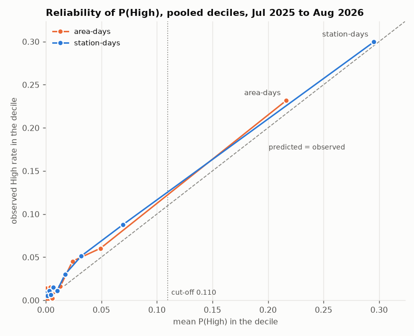

# Back-test error analysis (M1) and calibration check (M2)

Generated 2026-10-23 16:55 SGT by `scripts/analysis/error_analysis.py` at git `5bfa3ab` from the artifacts of MLflow run `c509ab9ad0d8464f8a1df07354b1bf98` (the run of `docs/checks/backtest.md`), saved in `backtest_run_c509ab9a` under `coolcheck-data/analysis/`: `predictions_area_days.parquet`, `predictions_station_days.parquet` and `labels_pinned.csv` (the run's pinned labels, for yesterday's category), plus the station names in `wbgt_stations.csv`. Analysis only: the model, its features, the back-test and the cut-off are unchanged.

**Dates.** Every dated input is filtered to dates on or before 2026-08-31 as it is read (a parquet filter; the CSV chunk by chunk), and the script asserts it. The latest date read is 2026-08-31. The final check (1 Sep to 19 Oct 2026) is not read, counted or plotted.

**Cut-off.** H4: an alert is P(High) ≥ 0.10975585695894975 (note §14). Check against `backtest_review.md`: the area-days give 1,180 alerts and 355 TP of 710 High, as there. Station-days use the same cut-off on their own P(High); it was chosen on the area-days, so their recall differs.

**Terms.** A *miss* is a High day without an alert. A *false alarm* is an alert on a day that was not High (Moderate or Low). Rates are written "X of Y (rate)": misses of the High days, false alarms of the alerts. An area-day repeats its station's station-day once per area the station serves that day, so the area-day counts weight a station by the number of areas it serves.

**Not available.** The NEA forecast text and the rainfall the day before (`rain_d1_mm`) are model features but are not in the prediction files, and no local file has them for the test rows (`forecast_fills.csv` has the text for the 4 filled dates only). They are not rebuilt here. What the model saw of the forecast is covered by its max temperature (`nea_score`, the forecast's `fc_temp_high` after the fill).

## Overview at the cut-off

| set | rows | High | alerts | caught | missed | false alarms | on Moderate | on Low |
|---|---|---|---|---|---|---|---|---|
| area-days (41 areas) | 17,438 | 710 | 1,180 | 355 of 710 (0.500) | 355 of 710 (0.500) | 825 of 1,180 (0.699) | 626 | 199 |
| station-days, all stations | 8,001 | 421 | 810 | 241 of 421 (0.572) | 180 of 421 (0.428) | 569 of 810 (0.702) | 419 | 150 |
| station-days, without S142, S137 and S135 | 7,089 | 206 | 439 | 87 of 206 (0.422) | 119 of 206 (0.578) | 352 of 439 (0.802) | 277 | 75 |
| station-days, the original 8 (7 after S130 stopped) | 3,335 | 106 | 215 | 57 of 106 (0.538) | 49 of 106 (0.462) | 158 of 215 (0.735) | 127 | 31 |

## M1.1 Misses and false alarms by station, month and season

Seasons are the run's season by year (`season_period`); within the test months SW monsoon 2025 is Jul to Sep 2025 and SW monsoon 2026 is Jun to Aug 2026.

### By station

#### area-days (41 areas), by the station serving the area

| station_id | name | panel | areas served | rows | High | alerts | missed High | false alarms | false alarms on Moderate | false alarms on Low |
|---|---|---|---|---|---|---|---|---|---|---|
| S124 | Upper Changi Road North | original 8 | 2 | 624 | 0 | 0 | 0 of 0 (—) | 0 of 0 (—) | 0 | 0 |
| S125 | Woodlands Street 13 | original 8 | 5 | 1,634 | 25 | 43 | 25 of 25 (1.000) | 43 of 43 (1.000) | 37 | 6 |
| S126 | Old Chua Chu Kang Road | original 8 | 4 | 750 | 39 | 91 | 22 of 39 (0.564) | 74 of 91 (0.813) | 59 | 15 |
| S127 | Stadium Road | original 8 | 12 | 2,157 | 36 | 46 | 28 of 36 (0.778) | 38 of 46 (0.826) | 32 | 6 |
| S128 | Bishan Street | original 8 | 9 | 2,014 | 209 | 394 | 59 of 209 (0.282) | 244 of 394 (0.619) | 192 | 52 |
| S129 | Bedok North Street 2 | original 8 | 3 | 1,049 | 11 | 44 | 8 of 11 (0.727) | 41 of 44 (0.932) | 33 | 8 |
| S130 | West Coast Road | original 8 | 5 | 736 | 4 | 1 | 4 of 4 (1.000) | 1 of 1 (1.000) | 1 | 0 |
| S131 | Hougang Stadium |  | 2 | 8 | 0 | 2 | 0 of 0 (—) | 2 of 2 (1.000) | 2 | 0 |
| S132 | Jurong West Street 93 | original 8 | 1 | 295 | 0 | 0 | 0 of 0 (—) | 0 of 0 (—) | 0 | 0 |
| S133 | Cathay Green |  | 6 | 24 | 0 | 6 | 0 of 0 (—) | 6 of 6 (1.000) | 6 | 0 |
| S135 | Bird Paradise | late starter | 1 | 131 | 16 | 48 | 4 of 16 (0.250) | 36 of 48 (0.750) | 28 | 8 |
| S138 | Stirling Road |  | 2 | 8 | 0 | 2 | 0 of 0 (—) | 2 of 2 (1.000) | 0 | 2 |
| S140 | Choa Chu Kang Stadium |  | 2 | 728 | 0 | 2 | 0 of 0 (—) | 2 of 2 (1.000) | 2 | 0 |
| S141 | Yio Chu Kang Stadium |  | 2 | 724 | 32 | 32 | 22 of 32 (0.688) | 22 of 32 (0.688) | 10 | 12 |
| S142 | Sentosa Palawan Green | late starter | 1 | 364 | 134 | 197 | 29 of 134 (0.216) | 92 of 197 (0.467) | 56 | 36 |
| S143 | Punggol North |  | 3 | 855 | 28 | 71 | 22 of 28 (0.786) | 65 of 71 (0.915) | 44 | 21 |
| S144 | Upper Pickering Street |  | 7 | 1,576 | 112 | 98 | 77 of 112 (0.688) | 63 of 98 (0.643) | 56 | 7 |
| S145 | MacRitchie Reservoir |  | 1 | 131 | 10 | 29 | 8 of 10 (0.800) | 27 of 29 (0.931) | 24 | 3 |
| S148 | Pasir Ris Walk |  | 1 | 131 | 1 | 12 | 1 of 1 (1.000) | 12 of 12 (1.000) | 10 | 2 |
| S149 | Tampines Walk |  | 2 | 325 | 0 | 0 | 0 of 0 (—) | 0 of 0 (—) | 0 | 0 |
| S150 | Evans Road |  | 2 | 448 | 6 | 2 | 6 of 6 (1.000) | 2 of 2 (1.000) | 2 | 0 |
| S153 | Bukit Batok Street 22 |  | 3 | 511 | 8 | 2 | 8 of 8 (1.000) | 2 of 2 (1.000) | 0 | 2 |
| S180 | Taman Jurong Greens |  | 1 | 131 | 2 | 14 | 1 of 2 (0.500) | 13 of 14 (0.929) | 12 | 1 |
| S184 | Sengkang East Avenue |  | 2 | 452 | 14 | 34 | 8 of 14 (0.571) | 28 of 34 (0.824) | 20 | 8 |
| S187 | Bukit Timah(West) |  | 7 | 1,632 | 23 | 10 | 23 of 23 (1.000) | 10 of 10 (1.000) | 0 | 10 |
| all |  |  | 41 | 17,438 | 710 | 1,180 | 355 of 710 (0.500) | 825 of 1,180 (0.699) | 626 | 199 |

#### station-days, all stations

The sets without S142, S137 and S135 and the original 8 are these rows (see the panel column).

| station_id | name | panel | rows | High | alerts | missed High | false alarms | false alarms on Moderate | false alarms on Low |
|---|---|---|---|---|---|---|---|---|---|
| S124 | Upper Changi Road North | original 8 | 426 | 0 | 0 | 0 of 0 (—) | 0 of 0 (—) | 0 | 0 |
| S125 | Woodlands Street 13 | original 8 | 425 | 7 | 14 | 7 of 7 (1.000) | 14 of 14 (1.000) | 12 | 2 |
| S126 | Old Chua Chu Kang Road | original 8 | 426 | 16 | 34 | 11 of 16 (0.688) | 29 of 34 (0.853) | 23 | 6 |
| S127 | Stadium Road | original 8 | 426 | 13 | 23 | 9 of 13 (0.692) | 19 of 23 (0.826) | 16 | 3 |
| S128 | Bishan Street | original 8 | 425 | 62 | 128 | 15 of 62 (0.242) | 81 of 128 (0.633) | 64 | 17 |
| S129 | Bedok North Street 2 | original 8 | 425 | 4 | 15 | 3 of 4 (0.750) | 14 of 15 (0.933) | 11 | 3 |
| S130 | West Coast Road | original 8 | 356 | 3 | 1 | 3 of 3 (1.000) | 1 of 1 (1.000) | 1 | 0 |
| S131 | Hougang Stadium |  | 4 | 0 | 1 | 0 of 0 (—) | 1 of 1 (1.000) | 1 | 0 |
| S132 | Jurong West Street 93 | original 8 | 426 | 1 | 0 | 1 of 1 (1.000) | 0 of 0 (—) | 0 | 0 |
| S133 | Cathay Green |  | 4 | 0 | 1 | 0 of 0 (—) | 1 of 1 (1.000) | 1 | 0 |
| S135 | Bird Paradise | late starter | 131 | 16 | 48 | 4 of 16 (0.250) | 36 of 48 (0.750) | 28 | 8 |
| S137 | Sakra Road | late starter | 417 | 65 | 126 | 28 of 65 (0.431) | 89 of 126 (0.706) | 58 | 31 |
| S138 | Stirling Road |  | 4 | 0 | 1 | 0 of 0 (—) | 1 of 1 (1.000) | 0 | 1 |
| S139 | Tuas Terminal Gateway |  | 364 | 0 | 1 | 0 of 0 (—) | 1 of 1 (1.000) | 0 | 1 |
| S140 | Choa Chu Kang Stadium |  | 364 | 0 | 1 | 0 of 0 (—) | 1 of 1 (1.000) | 1 | 0 |
| S141 | Yio Chu Kang Stadium |  | 362 | 16 | 16 | 11 of 16 (0.688) | 11 of 16 (0.688) | 5 | 6 |
| S142 | Sentosa Palawan Green | late starter | 364 | 134 | 197 | 29 of 134 (0.216) | 92 of 197 (0.467) | 56 | 36 |
| S143 | Punggol North |  | 361 | 14 | 32 | 11 of 14 (0.786) | 29 of 32 (0.906) | 20 | 9 |
| S144 | Upper Pickering Street |  | 228 | 16 | 14 | 11 of 16 (0.688) | 9 of 14 (0.643) | 8 | 1 |
| S145 | MacRitchie Reservoir |  | 131 | 10 | 29 | 8 of 10 (0.800) | 27 of 29 (0.931) | 24 | 3 |
| S146 | Jalan Bahar |  | 131 | 1 | 15 | 1 of 1 (1.000) | 15 of 15 (1.000) | 12 | 3 |
| S147 | Marina Barrage |  | 131 | 13 | 38 | 7 of 13 (0.538) | 32 of 38 (0.842) | 26 | 6 |
| S148 | Pasir Ris Walk |  | 131 | 1 | 12 | 1 of 1 (1.000) | 12 of 12 (1.000) | 10 | 2 |
| S149 | Tampines Walk |  | 228 | 0 | 0 | 0 of 0 (—) | 0 of 0 (—) | 0 | 0 |
| S150 | Evans Road |  | 228 | 3 | 1 | 3 of 3 (1.000) | 1 of 1 (1.000) | 1 | 0 |
| S151 | Outward Bound Singapore(Pulau ubin) |  | 131 | 8 | 27 | 3 of 8 (0.375) | 22 of 27 (0.815) | 19 | 3 |
| S153 | Bukit Batok Street 22 |  | 225 | 4 | 1 | 4 of 4 (1.000) | 1 of 1 (1.000) | 0 | 1 |
| S180 | Taman Jurong Greens |  | 131 | 2 | 14 | 1 of 2 (0.500) | 13 of 14 (0.929) | 12 | 1 |
| S184 | Sengkang East Avenue |  | 228 | 7 | 17 | 4 of 7 (0.571) | 14 of 17 (0.824) | 10 | 4 |
| S187 | Bukit Timah(West) |  | 364 | 5 | 2 | 5 of 5 (1.000) | 2 of 2 (1.000) | 0 | 2 |
| S910 | Outward Bound Singapore(East Coast) |  | 4 | 0 | 1 | 0 of 0 (—) | 1 of 1 (1.000) | 0 | 1 |
| all |  |  | 8,001 | 421 | 810 | 180 of 421 (0.428) | 569 of 810 (0.702) | 419 | 150 |

### By month

#### area-days (41 areas)

| month | rows | High | alerts | missed High | false alarms | false alarms on Moderate | false alarms on Low |
|---|---|---|---|---|---|---|---|
| 2025-07 | 1,261 | 31 | 61 | 12 of 31 (0.387) | 42 of 61 (0.689) | 35 | 7 |
| 2025-08 | 1,271 | 0 | 42 | 0 of 0 (—) | 42 of 42 (1.000) | 34 | 8 |
| 2025-09 | 1,213 | 38 | 18 | 36 of 38 (0.947) | 16 of 18 (0.889) | 6 | 10 |
| 2025-10 | 1,260 | 33 | 37 | 17 of 33 (0.515) | 21 of 37 (0.568) | 12 | 9 |
| 2025-11 | 1,225 | 32 | 46 | 27 of 32 (0.844) | 41 of 46 (0.891) | 26 | 15 |
| 2025-12 | 1,271 | 7 | 2 | 7 of 7 (1.000) | 2 of 2 (1.000) | 0 | 2 |
| 2026-01 | 1,271 | 0 | 2 | 0 of 0 (—) | 2 of 2 (1.000) | 0 | 2 |
| 2026-02 | 1,142 | 3 | 0 | 3 of 3 (1.000) | 0 of 0 (—) | 0 | 0 |
| 2026-03 | 1,269 | 22 | 2 | 22 of 22 (1.000) | 2 of 2 (1.000) | 2 | 0 |
| 2026-04 | 1,230 | 184 | 237 | 82 of 184 (0.446) | 135 of 237 (0.570) | 118 | 17 |
| 2026-05 | 1,269 | 158 | 319 | 88 of 158 (0.557) | 249 of 319 (0.781) | 195 | 54 |
| 2026-06 | 1,221 | 91 | 148 | 38 of 91 (0.418) | 95 of 148 (0.642) | 49 | 46 |
| 2026-07 | 1,264 | 48 | 127 | 14 of 48 (0.292) | 93 of 127 (0.732) | 75 | 18 |
| 2026-08 | 1,271 | 63 | 139 | 9 of 63 (0.143) | 85 of 139 (0.612) | 74 | 11 |
| all | 17,438 | 710 | 1,180 | 355 of 710 (0.500) | 825 of 1,180 (0.699) | 626 | 199 |

#### station-days, all stations

| month | rows | High | alerts | missed High | false alarms | false alarms on Moderate | false alarms on Low |
|---|---|---|---|---|---|---|---|
| 2025-07 | 268 | 12 | 18 | 6 of 12 (0.500) | 12 of 18 (0.667) | 10 | 2 |
| 2025-08 | 279 | 2 | 18 | 2 of 2 (1.000) | 18 of 18 (1.000) | 15 | 3 |
| 2025-09 | 439 | 25 | 7 | 24 of 25 (0.960) | 6 of 7 (0.857) | 3 | 3 |
| 2025-10 | 461 | 32 | 57 | 7 of 32 (0.219) | 32 of 57 (0.561) | 19 | 13 |
| 2025-11 | 448 | 18 | 60 | 6 of 18 (0.333) | 48 of 60 (0.800) | 30 | 18 |
| 2025-12 | 465 | 5 | 7 | 4 of 5 (0.800) | 6 of 7 (0.857) | 1 | 5 |
| 2026-01 | 545 | 0 | 1 | 0 of 0 (—) | 1 of 1 (1.000) | 0 | 1 |
| 2026-02 | 557 | 3 | 0 | 3 of 3 (1.000) | 0 of 0 (—) | 0 | 0 |
| 2026-03 | 619 | 9 | 1 | 9 of 9 (1.000) | 1 of 1 (1.000) | 1 | 0 |
| 2026-04 | 656 | 82 | 136 | 37 of 82 (0.451) | 91 of 136 (0.669) | 82 | 9 |
| 2026-05 | 836 | 97 | 245 | 42 of 97 (0.433) | 190 of 245 (0.776) | 148 | 42 |
| 2026-06 | 802 | 61 | 111 | 20 of 61 (0.328) | 70 of 111 (0.631) | 35 | 35 |
| 2026-07 | 804 | 33 | 72 | 9 of 33 (0.273) | 48 of 72 (0.667) | 36 | 12 |
| 2026-08 | 822 | 42 | 77 | 11 of 42 (0.262) | 46 of 77 (0.597) | 39 | 7 |
| all | 8,001 | 421 | 810 | 180 of 421 (0.428) | 569 of 810 (0.702) | 419 | 150 |

#### station-days, without S142, S137 and S135

| month | rows | High | alerts | missed High | false alarms | false alarms on Moderate | false alarms on Low |
|---|---|---|---|---|---|---|---|
| 2025-07 | 246 | 8 | 17 | 3 of 8 (0.375) | 12 of 17 (0.706) | 10 | 2 |
| 2025-08 | 248 | 0 | 11 | 0 of 0 (—) | 11 of 11 (1.000) | 9 | 2 |
| 2025-09 | 380 | 6 | 6 | 5 of 6 (0.833) | 5 of 6 (0.833) | 2 | 3 |
| 2025-10 | 399 | 4 | 3 | 4 of 4 (1.000) | 3 of 3 (1.000) | 2 | 1 |
| 2025-11 | 389 | 6 | 7 | 6 of 6 (1.000) | 7 of 7 (1.000) | 5 | 2 |
| 2025-12 | 403 | 1 | 0 | 1 of 1 (1.000) | 0 of 0 (—) | 0 | 0 |
| 2026-01 | 483 | 0 | 1 | 0 of 0 (—) | 1 of 1 (1.000) | 0 | 1 |
| 2026-02 | 501 | 1 | 0 | 1 of 1 (1.000) | 0 of 0 (—) | 0 | 0 |
| 2026-03 | 557 | 4 | 1 | 4 of 4 (1.000) | 1 of 1 (1.000) | 1 | 0 |
| 2026-04 | 588 | 61 | 100 | 26 of 61 (0.426) | 65 of 100 (0.650) | 59 | 6 |
| 2026-05 | 743 | 52 | 164 | 35 of 52 (0.673) | 147 of 164 (0.896) | 117 | 30 |
| 2026-06 | 712 | 31 | 47 | 19 of 31 (0.613) | 35 of 47 (0.745) | 16 | 19 |
| 2026-07 | 711 | 11 | 36 | 6 of 11 (0.545) | 31 of 36 (0.861) | 26 | 5 |
| 2026-08 | 729 | 21 | 46 | 9 of 21 (0.429) | 34 of 46 (0.739) | 30 | 4 |
| all | 7,089 | 206 | 439 | 119 of 206 (0.578) | 352 of 439 (0.802) | 277 | 75 |

#### station-days, the original 8 (7 after S130 stopped)

| month | rows | High | alerts | missed High | false alarms | false alarms on Moderate | false alarms on Low |
|---|---|---|---|---|---|---|---|
| 2025-07 | 246 | 8 | 17 | 3 of 8 (0.375) | 12 of 17 (0.706) | 10 | 2 |
| 2025-08 | 248 | 0 | 11 | 0 of 0 (—) | 11 of 11 (1.000) | 9 | 2 |
| 2025-09 | 235 | 3 | 0 | 3 of 3 (1.000) | 0 of 0 (—) | 0 | 0 |
| 2025-10 | 248 | 3 | 3 | 3 of 3 (1.000) | 3 of 3 (1.000) | 2 | 1 |
| 2025-11 | 239 | 5 | 2 | 5 of 5 (1.000) | 2 of 2 (1.000) | 2 | 0 |
| 2025-12 | 248 | 1 | 0 | 1 of 1 (1.000) | 0 of 0 (—) | 0 | 0 |
| 2026-01 | 248 | 0 | 0 | 0 of 0 (—) | 0 of 0 (—) | 0 | 0 |
| 2026-02 | 224 | 0 | 0 | 0 of 0 (—) | 0 of 0 (—) | 0 | 0 |
| 2026-03 | 247 | 3 | 0 | 3 of 3 (1.000) | 0 of 0 (—) | 0 | 0 |
| 2026-04 | 240 | 26 | 40 | 12 of 26 (0.462) | 26 of 40 (0.650) | 24 | 2 |
| 2026-05 | 247 | 19 | 43 | 8 of 19 (0.421) | 32 of 43 (0.744) | 26 | 6 |
| 2026-06 | 233 | 19 | 31 | 8 of 19 (0.421) | 20 of 31 (0.645) | 9 | 11 |
| 2026-07 | 215 | 7 | 33 | 2 of 7 (0.286) | 28 of 33 (0.848) | 23 | 5 |
| 2026-08 | 217 | 12 | 35 | 1 of 12 (0.083) | 24 of 35 (0.686) | 22 | 2 |
| all | 3,335 | 106 | 215 | 49 of 106 (0.462) | 158 of 215 (0.735) | 127 | 31 |

### By season

#### area-days (41 areas)

| season_year | months | rows | High | alerts | missed High | false alarms | false alarms on Moderate | false alarms on Low |
|---|---|---|---|---|---|---|---|---|
| SW monsoon 2025 | Jul 2025 to Sep 2025 | 3,745 | 69 | 121 | 48 of 69 (0.696) | 100 of 121 (0.826) | 75 | 25 |
| Inter-monsoon 2 2025 | Oct 2025 to Nov 2025 | 2,485 | 65 | 83 | 44 of 65 (0.677) | 62 of 83 (0.747) | 38 | 24 |
| NE monsoon 2025/26 | Dec 2025 to Feb 2026 | 3,684 | 10 | 4 | 10 of 10 (1.000) | 4 of 4 (1.000) | 0 | 4 |
| Inter-monsoon 1 2026 | Mar 2026 to May 2026 | 3,768 | 364 | 558 | 192 of 364 (0.527) | 386 of 558 (0.692) | 315 | 71 |
| SW monsoon 2026 | Jun 2026 to Aug 2026 | 3,756 | 202 | 414 | 61 of 202 (0.302) | 273 of 414 (0.659) | 198 | 75 |
| all | Jul 2025 to Aug 2026 | 17,438 | 710 | 1,180 | 355 of 710 (0.500) | 825 of 1,180 (0.699) | 626 | 199 |

#### station-days, all stations

| season_year | months | rows | High | alerts | missed High | false alarms | false alarms on Moderate | false alarms on Low |
|---|---|---|---|---|---|---|---|---|
| SW monsoon 2025 | Jul 2025 to Sep 2025 | 986 | 39 | 43 | 32 of 39 (0.821) | 36 of 43 (0.837) | 28 | 8 |
| Inter-monsoon 2 2025 | Oct 2025 to Nov 2025 | 909 | 50 | 117 | 13 of 50 (0.260) | 80 of 117 (0.684) | 49 | 31 |
| NE monsoon 2025/26 | Dec 2025 to Feb 2026 | 1,567 | 8 | 8 | 7 of 8 (0.875) | 7 of 8 (0.875) | 1 | 6 |
| Inter-monsoon 1 2026 | Mar 2026 to May 2026 | 2,111 | 188 | 382 | 88 of 188 (0.468) | 282 of 382 (0.738) | 231 | 51 |
| SW monsoon 2026 | Jun 2026 to Aug 2026 | 2,428 | 136 | 260 | 40 of 136 (0.294) | 164 of 260 (0.631) | 110 | 54 |
| all | Jul 2025 to Aug 2026 | 8,001 | 421 | 810 | 180 of 421 (0.428) | 569 of 810 (0.702) | 419 | 150 |

#### station-days, without S142, S137 and S135

| season_year | months | rows | High | alerts | missed High | false alarms | false alarms on Moderate | false alarms on Low |
|---|---|---|---|---|---|---|---|---|
| SW monsoon 2025 | Jul 2025 to Sep 2025 | 874 | 14 | 34 | 8 of 14 (0.571) | 28 of 34 (0.824) | 21 | 7 |
| Inter-monsoon 2 2025 | Oct 2025 to Nov 2025 | 788 | 10 | 10 | 10 of 10 (1.000) | 10 of 10 (1.000) | 7 | 3 |
| NE monsoon 2025/26 | Dec 2025 to Feb 2026 | 1,387 | 2 | 1 | 2 of 2 (1.000) | 1 of 1 (1.000) | 0 | 1 |
| Inter-monsoon 1 2026 | Mar 2026 to May 2026 | 1,888 | 117 | 265 | 65 of 117 (0.556) | 213 of 265 (0.804) | 177 | 36 |
| SW monsoon 2026 | Jun 2026 to Aug 2026 | 2,152 | 63 | 129 | 34 of 63 (0.540) | 100 of 129 (0.775) | 72 | 28 |
| all | Jul 2025 to Aug 2026 | 7,089 | 206 | 439 | 119 of 206 (0.578) | 352 of 439 (0.802) | 277 | 75 |

#### station-days, the original 8 (7 after S130 stopped)

| season_year | months | rows | High | alerts | missed High | false alarms | false alarms on Moderate | false alarms on Low |
|---|---|---|---|---|---|---|---|---|
| SW monsoon 2025 | Jul 2025 to Sep 2025 | 729 | 11 | 28 | 6 of 11 (0.545) | 23 of 28 (0.821) | 19 | 4 |
| Inter-monsoon 2 2025 | Oct 2025 to Nov 2025 | 487 | 8 | 5 | 8 of 8 (1.000) | 5 of 5 (1.000) | 4 | 1 |
| NE monsoon 2025/26 | Dec 2025 to Feb 2026 | 720 | 1 | 0 | 1 of 1 (1.000) | 0 of 0 (—) | 0 | 0 |
| Inter-monsoon 1 2026 | Mar 2026 to May 2026 | 734 | 48 | 83 | 23 of 48 (0.479) | 58 of 83 (0.699) | 50 | 8 |
| SW monsoon 2026 | Jun 2026 to Aug 2026 | 665 | 38 | 99 | 11 of 38 (0.289) | 72 of 99 (0.727) | 54 | 18 |
| all | Jul 2025 to Aug 2026 | 3,335 | 106 | 215 | 49 of 106 (0.462) | 158 of 215 (0.735) | 127 | 31 |

## M1.2 The misses split

High days only. Each block is one set; "missed" is of the group's High days, "share" of the set's misses.

### High readings that day (`label_n_high`)

| set | High readings | High | missed | share of the set's misses |
|---|---|---|---|---|
| area-days (41 areas) | 1 or 2 High readings | 453 | 262 of 453 (0.578) | 262 of 355 (0.738) |
|  | 3 or more High readings (sustained) | 257 | 93 of 257 (0.362) | 93 of 355 (0.262) |
|  | all High | 710 | 355 of 710 (0.500) | 355 of 355 (1.000) |
| station-days, all stations | 1 or 2 High readings | 223 | 121 of 223 (0.543) | 121 of 180 (0.672) |
|  | 3 or more High readings (sustained) | 198 | 59 of 198 (0.298) | 59 of 180 (0.328) |
|  | all High | 421 | 180 of 421 (0.428) | 180 of 180 (1.000) |
| station-days, without S142, S137 and S135 | 1 or 2 High readings | 148 | 90 of 148 (0.608) | 90 of 119 (0.756) |
|  | 3 or more High readings (sustained) | 58 | 29 of 58 (0.500) | 29 of 119 (0.244) |
|  | all High | 206 | 119 of 206 (0.578) | 119 of 119 (1.000) |
| station-days, the original 8 (7 after S130 stopped) | 1 or 2 High readings | 77 | 37 of 77 (0.481) | 37 of 49 (0.755) |
|  | 3 or more High readings (sustained) | 29 | 12 of 29 (0.414) | 12 of 49 (0.245) |
|  | all High | 106 | 49 of 106 (0.462) | 49 of 49 (1.000) |

### First day of a spell or a later day: yesterday as the model saw it (`n_high_d1`)

"High yesterday" (a later day of a spell) is one or more High readings at the row's station on the day before (persistence's rule); "not High yesterday" is the first High day; "no WBGT reading yesterday" is a station with no reading that day (the model saw a missing value).

| set | yesterday | High | missed | share of the set's misses |
|---|---|---|---|---|
| area-days (41 areas) | not High yesterday | 465 | 315 of 465 (0.677) | 315 of 355 (0.887) |
|  | High yesterday | 245 | 40 of 245 (0.163) | 40 of 355 (0.113) |
|  | no WBGT reading yesterday | 0 | 0 of 0 (—) | 0 of 355 (0.000) |
|  | all High | 710 | 355 of 710 (0.500) | 355 of 355 (1.000) |
| station-days, all stations | not High yesterday | 260 | 154 of 260 (0.592) | 154 of 180 (0.856) |
|  | High yesterday | 161 | 26 of 161 (0.161) | 26 of 180 (0.144) |
|  | no WBGT reading yesterday | 0 | 0 of 0 (—) | 0 of 180 (0.000) |
|  | all High | 421 | 180 of 421 (0.428) | 180 of 180 (1.000) |
| station-days, without S142, S137 and S135 | not High yesterday | 153 | 109 of 153 (0.712) | 109 of 119 (0.916) |
|  | High yesterday | 53 | 10 of 53 (0.189) | 10 of 119 (0.084) |
|  | no WBGT reading yesterday | 0 | 0 of 0 (—) | 0 of 119 (0.000) |
|  | all High | 206 | 119 of 206 (0.578) | 119 of 119 (1.000) |
| station-days, the original 8 (7 after S130 stopped) | not High yesterday | 75 | 47 of 75 (0.627) | 47 of 49 (0.959) |
|  | High yesterday | 31 | 2 of 31 (0.065) | 2 of 49 (0.041) |
|  | no WBGT reading yesterday | 0 | 0 of 0 (—) | 0 of 49 (0.000) |
|  | all High | 106 | 49 of 106 (0.462) | 49 of 49 (1.000) |

### Yesterday's label (the run's pinned labels, same station)

| set | yesterday's label | High | missed | share of the set's misses |
|---|---|---|---|---|
| area-days (41 areas) | Low | 101 | 74 of 101 (0.733) | 74 of 355 (0.208) |
|  | Moderate | 363 | 241 of 363 (0.664) | 241 of 355 (0.679) |
|  | High | 245 | 40 of 245 (0.163) | 40 of 355 (0.113) |
|  | no usable label | 1 | 0 of 1 (0.000) | 0 of 355 (0.000) |
|  | all High | 710 | 355 of 710 (0.500) | 355 of 355 (1.000) |
| station-days, all stations | Low | 59 | 36 of 59 (0.610) | 36 of 180 (0.200) |
|  | Moderate | 198 | 118 of 198 (0.596) | 118 of 180 (0.656) |
|  | High | 161 | 26 of 161 (0.161) | 26 of 180 (0.144) |
|  | no usable label | 3 | 0 of 3 (0.000) | 0 of 180 (0.000) |
|  | all High | 421 | 180 of 421 (0.428) | 180 of 180 (1.000) |
| station-days, without S142, S137 and S135 | Low | 26 | 21 of 26 (0.808) | 21 of 119 (0.176) |
|  | Moderate | 126 | 88 of 126 (0.698) | 88 of 119 (0.739) |
|  | High | 53 | 10 of 53 (0.189) | 10 of 119 (0.084) |
|  | no usable label | 1 | 0 of 1 (0.000) | 0 of 119 (0.000) |
|  | all High | 206 | 119 of 206 (0.578) | 119 of 119 (1.000) |
| station-days, the original 8 (7 after S130 stopped) | Low | 15 | 11 of 15 (0.733) | 11 of 49 (0.224) |
|  | Moderate | 60 | 36 of 60 (0.600) | 36 of 49 (0.735) |
|  | High | 31 | 2 of 31 (0.065) | 2 of 49 (0.041) |
|  | no usable label | 0 | 0 of 0 (—) | 0 of 49 (0.000) |
|  | all High | 106 | 49 of 106 (0.462) | 49 of 49 (1.000) |

Station-days, all rows: yesterday as the model saw it against yesterday's pinned label (a check that the two agree):

| as the model saw it | High | Low | Moderate | no usable label |
|---|---|---|---|---|
| High yesterday | 416 | 0 | 0 | 0 |
| no WBGT reading yesterday | 0 | 0 | 0 | 1 |
| not High yesterday | 0 | 4,161 | 3,387 | 36 |

### What the model saw: the NEA forecast's max temperature (`nea_score`)

| set | forecast max temperature | High | missed | share of the set's misses |
|---|---|---|---|---|
| area-days (41 areas) | 30 °C | 0 | 0 of 0 (—) | 0 of 355 (0.000) |
|  | 31 °C | 1 | 1 of 1 (1.000) | 1 of 355 (0.003) |
|  | 32 °C | 3 | 2 of 3 (0.667) | 2 of 355 (0.006) |
|  | 33 °C | 172 | 81 of 172 (0.471) | 81 of 355 (0.228) |
|  | 34 °C | 482 | 258 of 482 (0.535) | 258 of 355 (0.727) |
|  | 35 °C | 35 | 11 of 35 (0.314) | 11 of 355 (0.031) |
|  | 36 °C | 0 | 0 of 0 (—) | 0 of 355 (0.000) |
|  | no qualifying forecast (filled) | 17 | 2 of 17 (0.118) | 2 of 355 (0.006) |
|  | all High | 710 | 355 of 710 (0.500) | 355 of 355 (1.000) |
| station-days, all stations | 30 °C | 0 | 0 of 0 (—) | 0 of 180 (0.000) |
|  | 31 °C | 1 | 1 of 1 (1.000) | 1 of 180 (0.006) |
|  | 32 °C | 3 | 1 of 3 (0.333) | 1 of 180 (0.006) |
|  | 33 °C | 126 | 53 of 126 (0.421) | 53 of 180 (0.294) |
|  | 34 °C | 251 | 112 of 251 (0.446) | 112 of 180 (0.622) |
|  | 35 °C | 31 | 11 of 31 (0.355) | 11 of 180 (0.061) |
|  | 36 °C | 0 | 0 of 0 (—) | 0 of 180 (0.000) |
|  | no qualifying forecast (filled) | 9 | 2 of 9 (0.222) | 2 of 180 (0.011) |
|  | all High | 421 | 180 of 421 (0.428) | 180 of 180 (1.000) |
| station-days, without S142, S137 and S135 | 30 °C | 0 | 0 of 0 (—) | 0 of 119 (0.000) |
|  | 31 °C | 0 | 0 of 0 (—) | 0 of 119 (0.000) |
|  | 32 °C | 1 | 1 of 1 (1.000) | 1 of 119 (0.008) |
|  | 33 °C | 47 | 29 of 47 (0.617) | 29 of 119 (0.244) |
|  | 34 °C | 145 | 85 of 145 (0.586) | 85 of 119 (0.714) |
|  | 35 °C | 6 | 3 of 6 (0.500) | 3 of 119 (0.025) |
|  | 36 °C | 0 | 0 of 0 (—) | 0 of 119 (0.000) |
|  | no qualifying forecast (filled) | 7 | 1 of 7 (0.143) | 1 of 119 (0.008) |
|  | all High | 206 | 119 of 206 (0.578) | 119 of 119 (1.000) |
| station-days, the original 8 (7 after S130 stopped) | 30 °C | 0 | 0 of 0 (—) | 0 of 49 (0.000) |
|  | 31 °C | 0 | 0 of 0 (—) | 0 of 49 (0.000) |
|  | 32 °C | 0 | 0 of 0 (—) | 0 of 49 (0.000) |
|  | 33 °C | 26 | 11 of 26 (0.423) | 11 of 49 (0.224) |
|  | 34 °C | 74 | 36 of 74 (0.486) | 36 of 49 (0.735) |
|  | 35 °C | 5 | 2 of 5 (0.400) | 2 of 49 (0.041) |
|  | 36 °C | 0 | 0 of 0 (—) | 0 of 49 (0.000) |
|  | no qualifying forecast (filled) | 1 | 0 of 1 (0.000) | 0 of 49 (0.000) |
|  | all High | 106 | 49 of 106 (0.462) | 49 of 49 (1.000) |

### What the model saw: yesterday's peak WBGT (`wbgt_peak_d1`)

Bands are the quartiles of yesterday's peak over the 421 High station-days with a reading (all stations): 31.6, 32.6 and 33.3 °C, taken from the data. They are not heat-category cut-offs.

| set | yesterday's peak | High | missed | share of the set's misses |
|---|---|---|---|---|
| area-days (41 areas) | below 31.6 °C | 178 | 131 of 178 (0.736) | 131 of 355 (0.369) |
|  | 31.6 to below 32.6 °C | 187 | 136 of 187 (0.727) | 136 of 355 (0.383) |
|  | 32.6 to below 33.3 °C | 191 | 70 of 191 (0.366) | 70 of 355 (0.197) |
|  | 33.3 °C or above | 154 | 18 of 154 (0.117) | 18 of 355 (0.051) |
|  | no WBGT reading yesterday | 0 | 0 of 0 (—) | 0 of 355 (0.000) |
|  | all High | 710 | 355 of 710 (0.500) | 355 of 355 (1.000) |
| station-days, all stations | below 31.6 °C | 103 | 64 of 103 (0.621) | 64 of 180 (0.356) |
|  | 31.6 to below 32.6 °C | 101 | 66 of 101 (0.653) | 66 of 180 (0.367) |
|  | 32.6 to below 33.3 °C | 104 | 33 of 104 (0.317) | 33 of 180 (0.183) |
|  | 33.3 °C or above | 113 | 17 of 113 (0.150) | 17 of 180 (0.094) |
|  | no WBGT reading yesterday | 0 | 0 of 0 (—) | 0 of 180 (0.000) |
|  | all High | 421 | 180 of 421 (0.428) | 180 of 180 (1.000) |
| station-days, without S142, S137 and S135 | below 31.6 °C | 52 | 40 of 52 (0.769) | 40 of 119 (0.336) |
|  | 31.6 to below 32.6 °C | 67 | 52 of 67 (0.776) | 52 of 119 (0.437) |
|  | 32.6 to below 33.3 °C | 60 | 24 of 60 (0.400) | 24 of 119 (0.202) |
|  | 33.3 °C or above | 27 | 3 of 27 (0.111) | 3 of 119 (0.025) |
|  | no WBGT reading yesterday | 0 | 0 of 0 (—) | 0 of 119 (0.000) |
|  | all High | 206 | 119 of 206 (0.578) | 119 of 119 (1.000) |
| station-days, the original 8 (7 after S130 stopped) | below 31.6 °C | 29 | 21 of 29 (0.724) | 21 of 49 (0.429) |
|  | 31.6 to below 32.6 °C | 30 | 20 of 30 (0.667) | 20 of 49 (0.408) |
|  | 32.6 to below 33.3 °C | 29 | 7 of 29 (0.241) | 7 of 49 (0.143) |
|  | 33.3 °C or above | 18 | 1 of 18 (0.056) | 1 of 49 (0.020) |
|  | no WBGT reading yesterday | 0 | 0 of 0 (—) | 0 of 49 (0.000) |
|  | all High | 106 | 49 of 106 (0.462) | 49 of 49 (1.000) |

### Medians: missed against caught High days

Yesterday's peak over the rows with a reading; the forecast over the rows with a qualifying forecast.

| set | High days | rows | yesterday's peak WBGT, median °C | forecast max temperature, median °C |
|---|---|---|---|---|
| area-days (41 areas) | missed | 355 | 32.0 (n = 355) | 34 (n = 353) |
|  | caught | 355 | 33.1 (n = 355) | 34 (n = 340) |
| station-days, all stations | missed | 180 | 32.1 (n = 180) | 34 (n = 178) |
|  | caught | 241 | 33.1 (n = 241) | 34 (n = 234) |
| station-days, without S142, S137 and S135 | missed | 119 | 32.0 (n = 119) | 34 (n = 118) |
|  | caught | 87 | 32.9 (n = 87) | 34 (n = 81) |
| station-days, the original 8 (7 after S130 stopped) | missed | 49 | 31.8 (n = 49) | 34 (n = 49) |
|  | caught | 57 | 33.0 (n = 57) | 34 (n = 56) |

### A station's first 30 days

Days since the station's first pinned label (the labels start on 16 Jan 2025, so a station reporting before then is past its first 30 days in every test month). Not one of the planned splits: added to explain S142's first month (M1.3).

| set | station age | High | missed | share of the set's misses |
|---|---|---|---|---|
| area-days (41 areas) | in the station's first 30 days | 42 | 29 of 42 (0.690) | 29 of 355 (0.082) |
|  | later | 668 | 326 of 668 (0.488) | 326 of 355 (0.918) |
|  | all High | 710 | 355 of 710 (0.500) | 355 of 355 (1.000) |
| station-days, all stations | in the station's first 30 days | 52 | 29 of 52 (0.558) | 29 of 180 (0.161) |
|  | later | 369 | 151 of 369 (0.409) | 151 of 180 (0.839) |
|  | all High | 421 | 180 of 421 (0.428) | 180 of 180 (1.000) |
| station-days, without S142, S137 and S135 | in the station's first 30 days | 23 | 9 of 23 (0.391) | 9 of 119 (0.076) |
|  | later | 183 | 110 of 183 (0.601) | 110 of 119 (0.924) |
|  | all High | 206 | 119 of 206 (0.578) | 119 of 119 (1.000) |
| station-days, the original 8 (7 after S130 stopped) | in the station's first 30 days | 0 | 0 of 0 (—) | 0 of 49 (0.000) |
|  | later | 106 | 49 of 106 (0.462) | 49 of 49 (1.000) |
|  | all High | 106 | 49 of 106 (0.462) | 49 of 49 (1.000) |

## M1.3 Where the misses sit

### Stations, Jul 2025 to Aug 2026

Sorted by area-day misses. Stations with no High day in either set are left out.

| station | name | panel | station-days missed | share of station-day misses | area-days missed | share of area-day misses | areas served |
|---|---|---|---|---|---|---|---|
| S144 | Upper Pickering Street |  | 11 of 16 (0.688) | 11 of 180 (0.061) | 77 of 112 (0.688) | 77 of 355 (0.217) | 7 |
| S128 | Bishan Street | original 8 | 15 of 62 (0.242) | 15 of 180 (0.083) | 59 of 209 (0.282) | 59 of 355 (0.166) | 9 |
| S142 | Sentosa Palawan Green | late starter | 29 of 134 (0.216) | 29 of 180 (0.161) | 29 of 134 (0.216) | 29 of 355 (0.082) | 1 |
| S127 | Stadium Road | original 8 | 9 of 13 (0.692) | 9 of 180 (0.050) | 28 of 36 (0.778) | 28 of 355 (0.079) | 12 |
| S125 | Woodlands Street 13 | original 8 | 7 of 7 (1.000) | 7 of 180 (0.039) | 25 of 25 (1.000) | 25 of 355 (0.070) | 5 |
| S187 | Bukit Timah(West) |  | 5 of 5 (1.000) | 5 of 180 (0.028) | 23 of 23 (1.000) | 23 of 355 (0.065) | 7 |
| S126 | Old Chua Chu Kang Road | original 8 | 11 of 16 (0.688) | 11 of 180 (0.061) | 22 of 39 (0.564) | 22 of 355 (0.062) | 4 |
| S141 | Yio Chu Kang Stadium |  | 11 of 16 (0.688) | 11 of 180 (0.061) | 22 of 32 (0.688) | 22 of 355 (0.062) | 2 |
| S143 | Punggol North |  | 11 of 14 (0.786) | 11 of 180 (0.061) | 22 of 28 (0.786) | 22 of 355 (0.062) | 3 |
| S145 | MacRitchie Reservoir |  | 8 of 10 (0.800) | 8 of 180 (0.044) | 8 of 10 (0.800) | 8 of 355 (0.023) | 1 |
| S153 | Bukit Batok Street 22 |  | 4 of 4 (1.000) | 4 of 180 (0.022) | 8 of 8 (1.000) | 8 of 355 (0.023) | 3 |
| S184 | Sengkang East Avenue |  | 4 of 7 (0.571) | 4 of 180 (0.022) | 8 of 14 (0.571) | 8 of 355 (0.023) | 2 |
| S129 | Bedok North Street 2 | original 8 | 3 of 4 (0.750) | 3 of 180 (0.017) | 8 of 11 (0.727) | 8 of 355 (0.023) | 3 |
| S150 | Evans Road |  | 3 of 3 (1.000) | 3 of 180 (0.017) | 6 of 6 (1.000) | 6 of 355 (0.017) | 2 |
| S135 | Bird Paradise | late starter | 4 of 16 (0.250) | 4 of 180 (0.022) | 4 of 16 (0.250) | 4 of 355 (0.011) | 1 |
| S130 | West Coast Road | original 8 | 3 of 3 (1.000) | 3 of 180 (0.017) | 4 of 4 (1.000) | 4 of 355 (0.011) | 5 |
| S148 | Pasir Ris Walk |  | 1 of 1 (1.000) | 1 of 180 (0.006) | 1 of 1 (1.000) | 1 of 355 (0.003) | 1 |
| S180 | Taman Jurong Greens |  | 1 of 2 (0.500) | 1 of 180 (0.006) | 1 of 2 (0.500) | 1 of 355 (0.003) | 1 |
| S137 | Sakra Road | late starter | 28 of 65 (0.431) | 28 of 180 (0.156) | 0 of 0 (—) | 0 of 355 (0.000) | 0 |
| S147 | Marina Barrage |  | 7 of 13 (0.538) | 7 of 180 (0.039) | 0 of 0 (—) | 0 of 355 (0.000) | 0 |
| S151 | Outward Bound Singapore(Pulau ubin) |  | 3 of 8 (0.375) | 3 of 180 (0.017) | 0 of 0 (—) | 0 of 355 (0.000) | 0 |
| S132 | Jurong West Street 93 | original 8 | 1 of 1 (1.000) | 1 of 180 (0.006) | 0 of 0 (—) | 0 of 355 (0.000) | 1 |
| S146 | Jalan Bahar |  | 1 of 1 (1.000) | 1 of 180 (0.006) | 0 of 0 (—) | 0 of 355 (0.000) | 0 |

### Planning areas with the most misses, Jul 2025 to Aug 2026 (top 10)

"Stations behind its misses": the stations that served the area on its missed days, with the count.

| planning area | area-days | missed High | share of area-day misses | stations behind its misses |
|---|---|---|---|---|
| SOUTHERN ISLANDS | 427 | 29 of 134 (0.216) | 29 of 355 (0.082) | S142 (29) |
| NOVENA | 425 | 18 of 29 (0.621) | 18 of 355 (0.051) | S128 (10), S145 (8) |
| BISHAN | 425 | 15 of 62 (0.242) | 15 of 355 (0.042) | S128 (15) |
| SERANGOON | 425 | 15 of 62 (0.242) | 15 of 355 (0.042) | S128 (15) |
| TOA PAYOH | 425 | 15 of 62 (0.242) | 15 of 355 (0.042) | S128 (15) |
| BUKIT MERAH | 427 | 13 of 18 (0.722) | 13 of 355 (0.037) | S144 (11), S187 (2) |
| DOWNTOWN CORE | 426 | 13 of 18 (0.722) | 13 of 355 (0.037) | S144 (11), S127 (2) |
| MUSEUM | 426 | 13 of 18 (0.722) | 13 of 355 (0.037) | S144 (11), S127 (2) |
| OUTRAM | 426 | 13 of 18 (0.722) | 13 of 355 (0.037) | S144 (11), S127 (2) |
| RIVER VALLEY | 427 | 13 of 18 (0.722) | 13 of 355 (0.037) | S144 (11), S187 (2) |

### The areas S142 served, Jul 2025 to Aug 2026

"Of its area-days": the share of the area's test days on which S142 was its station.

| planning area | area-days served by S142 | of its area-days | missed High | false alarms |
|---|---|---|---|---|
| SOUTHERN ISLANDS | 364 | 364 of 427 (0.852) | 29 of 134 (0.216) | 92 of 197 (0.467) |

### S142 by month (station-days)

S142's first pinned label is 2025-09-01.

| month | highest P(High) on its High days | High days after a High day | rows | High | alerts | missed High | false alarms | false alarms on Moderate | false alarms on Low |
|---|---|---|---|---|---|---|---|---|---|
| 2025-09 | 0.101 | 8 | 29 | 15 | 1 | 15 of 15 (1.000) | 1 of 1 (1.000) | 1 | 0 |
| 2025-10 | 0.896 | 11 | 31 | 18 | 28 | 2 of 18 (0.111) | 12 of 28 (0.429) | 6 | 6 |
| 2025-11 | 0.739 | 3 | 30 | 5 | 25 | 0 of 5 (0.000) | 20 of 25 (0.800) | 11 | 9 |
| 2025-12 | 0.036 | 0 | 31 | 2 | 2 | 2 of 2 (1.000) | 2 of 2 (1.000) | 0 | 2 |
| 2026-01 | — | 0 | 31 | 0 | 0 | 0 of 0 (—) | 0 of 0 (—) | 0 | 0 |
| 2026-02 | 0.007 | 0 | 28 | 1 | 0 | 1 of 1 (1.000) | 0 of 0 (—) | 0 | 0 |
| 2026-03 | 0.041 | 3 | 31 | 3 | 0 | 3 of 3 (1.000) | 0 of 0 (—) | 0 | 0 |
| 2026-04 | 0.299 | 3 | 30 | 11 | 18 | 6 of 11 (0.545) | 13 of 18 (0.722) | 10 | 3 |
| 2026-05 | 0.599 | 15 | 31 | 21 | 31 | 0 of 21 (0.000) | 10 of 31 (0.323) | 7 | 3 |
| 2026-06 | 0.771 | 15 | 30 | 20 | 30 | 0 of 20 (0.000) | 10 of 30 (0.333) | 5 | 5 |
| 2026-07 | 0.703 | 10 | 31 | 19 | 31 | 0 of 19 (0.000) | 12 of 31 (0.387) | 7 | 5 |
| 2026-08 | 0.780 | 14 | 31 | 19 | 31 | 0 of 19 (0.000) | 12 of 31 (0.387) | 9 | 3 |
| all | 0.896 | 82 | 364 | 134 | 197 | 29 of 134 (0.216) | 92 of 197 (0.467) | 56 | 36 |

### Stations, Apr to Jun 2026

| station | name | panel | station-days missed | share of station-day misses | area-days missed | share of area-day misses | areas served |
|---|---|---|---|---|---|---|---|
| S144 | Upper Pickering Street |  | 9 of 14 (0.643) | 9 of 99 (0.091) | 63 of 98 (0.643) | 63 of 208 (0.303) | 7 |
| S128 | Bishan Street | original 8 | 9 of 40 (0.225) | 9 of 99 (0.091) | 31 of 133 (0.233) | 31 of 208 (0.149) | 4 |
| S141 | Yio Chu Kang Stadium |  | 9 of 13 (0.692) | 9 of 99 (0.091) | 18 of 26 (0.692) | 18 of 208 (0.087) | 2 |
| S143 | Punggol North |  | 8 of 10 (0.800) | 8 of 99 (0.081) | 16 of 20 (0.800) | 16 of 208 (0.077) | 2 |
| S125 | Woodlands Street 13 | original 8 | 4 of 4 (1.000) | 4 of 99 (0.040) | 14 of 14 (1.000) | 14 of 208 (0.067) | 4 |
| S127 | Stadium Road | original 8 | 6 of 10 (0.600) | 6 of 99 (0.061) | 12 of 20 (0.600) | 12 of 208 (0.058) | 2 |
| S187 | Bukit Timah(West) |  | 3 of 3 (1.000) | 3 of 99 (0.030) | 9 of 9 (1.000) | 9 of 208 (0.043) | 3 |
| S184 | Sengkang East Avenue |  | 4 of 7 (0.571) | 4 of 99 (0.040) | 8 of 14 (0.571) | 8 of 208 (0.038) | 2 |
| S142 | Sentosa Palawan Green | late starter | 6 of 52 (0.115) | 6 of 99 (0.061) | 6 of 52 (0.115) | 6 of 208 (0.029) | 1 |
| S145 | MacRitchie Reservoir |  | 6 of 8 (0.750) | 6 of 99 (0.061) | 6 of 8 (0.750) | 6 of 208 (0.029) | 1 |
| S150 | Evans Road |  | 3 of 3 (1.000) | 3 of 99 (0.030) | 6 of 6 (1.000) | 6 of 208 (0.029) | 2 |
| S153 | Bukit Batok Street 22 |  | 3 of 3 (1.000) | 3 of 99 (0.030) | 6 of 6 (1.000) | 6 of 208 (0.029) | 2 |
| S126 | Old Chua Chu Kang Road | original 8 | 5 of 6 (0.833) | 5 of 99 (0.051) | 5 of 6 (0.833) | 5 of 208 (0.024) | 1 |
| S135 | Bird Paradise | late starter | 3 of 15 (0.200) | 3 of 99 (0.030) | 3 of 15 (0.200) | 3 of 208 (0.014) | 1 |
| S130 | West Coast Road | original 8 | 2 of 2 (1.000) | 2 of 99 (0.020) | 2 of 2 (1.000) | 2 of 208 (0.010) | 1 |
| S129 | Bedok North Street 2 | original 8 | 1 of 1 (1.000) | 1 of 99 (0.010) | 2 of 2 (1.000) | 2 of 208 (0.010) | 2 |
| S180 | Taman Jurong Greens |  | 1 of 2 (0.500) | 1 of 99 (0.010) | 1 of 2 (0.500) | 1 of 208 (0.005) | 1 |
| S137 | Sakra Road | late starter | 10 of 29 (0.345) | 10 of 99 (0.101) | 0 of 0 (—) | 0 of 208 (0.000) | 0 |
| S147 | Marina Barrage |  | 3 of 9 (0.333) | 3 of 99 (0.030) | 0 of 0 (—) | 0 of 208 (0.000) | 0 |
| S151 | Outward Bound Singapore(Pulau ubin) |  | 3 of 8 (0.375) | 3 of 99 (0.030) | 0 of 0 (—) | 0 of 208 (0.000) | 0 |
| S132 | Jurong West Street 93 | original 8 | 1 of 1 (1.000) | 1 of 99 (0.010) | 0 of 0 (—) | 0 of 208 (0.000) | 1 |

### Planning areas with the most misses, Apr to Jun 2026 (top 10)

| planning area | area-days | missed High | share of area-day misses | stations behind its misses |
|---|---|---|---|---|
| NOVENA | 91 | 10 of 21 (0.476) | 10 of 208 (0.048) | S145 (6), S128 (4) |
| BISHAN | 91 | 9 of 40 (0.225) | 9 of 208 (0.043) | S128 (9) |
| SERANGOON | 91 | 9 of 40 (0.225) | 9 of 208 (0.043) | S128 (9) |
| TOA PAYOH | 91 | 9 of 40 (0.225) | 9 of 208 (0.043) | S128 (9) |
| BUKIT MERAH | 91 | 9 of 14 (0.643) | 9 of 208 (0.043) | S144 (9) |
| DOWNTOWN CORE | 91 | 9 of 14 (0.643) | 9 of 208 (0.043) | S144 (9) |
| MUSEUM | 91 | 9 of 14 (0.643) | 9 of 208 (0.043) | S144 (9) |
| OUTRAM | 91 | 9 of 14 (0.643) | 9 of 208 (0.043) | S144 (9) |
| RIVER VALLEY | 91 | 9 of 14 (0.643) | 9 of 208 (0.043) | S144 (9) |
| ROCHOR | 91 | 9 of 14 (0.643) | 9 of 208 (0.043) | S144 (9) |

### The areas S142 served, Apr to Jun 2026

| planning area | area-days served by S142 | of its area-days | missed High | false alarms |
|---|---|---|---|---|
| SOUTHERN ISLANDS | 91 | 91 of 91 (1.000) | 6 of 52 (0.115) | 33 of 79 (0.418) |

## M1.4 Findings

For a limitations slide. Each finding gives its counts (*measured*: from the tables above, or from the same predictions where a finding shows its own table); an explanation, where given, is labelled *reading*: an interpretation of the counts, not a measurement.

1. **The model misses the first day of a hot spell.** *Measured.* On the area-days it misses 315 of 465 (0.677) first High days (not High the day before) against 40 of 245 (0.163) later days of a spell; first days are 315 of 355 (0.887) of the misses. Station-days, all stations: 154 of 260 (0.592) against 26 of 161 (0.161). On 241 of 355 (0.679) missed area-days the day before was Moderate. *Reading* (an interpretation, not a measurement). The model leans on the day before (yesterday's peak and its High readings); a spell's first day follows a day that looks like any other Moderate day, so it scores low.

   *Measured, beside persistence (area-days).* Persistence alerts when the station was High yesterday, so by construction it catches every later day of a spell and no first day. It alerts on 700 area-days and the model at the cut-off on 1,180, so the two are not at the same load; at the same load (the model's 700 highest P(High)) the back-test found both catch 245 of 710 High area-days (`backtest.md`).

   | High area-days | High | caught by the model (P(High) ≥ cut-off) | caught by persistence (High yesterday) |
   |---|---|---|---|
   | first day of a spell (not High yesterday) | 465 | 150 of 465 (0.323) | 0 of 465 (0.000) |
   | later day of a spell (High yesterday) | 245 | 205 of 245 (0.837) | 245 of 245 (1.000) |
   | all High | 710 | 355 of 710 (0.500) | 245 of 710 (0.345) |

2. **Short High days are missed more often than sustained ones.** *Measured.* Area-days with 1 or 2 High readings: 262 of 453 (0.578) missed; with 3 or more: 93 of 257 (0.362). Short days are 262 of 355 (0.738) of the misses. Station-days, all stations: 121 of 223 (0.543) against 59 of 198 (0.298). *Reading* (an interpretation, not a measurement). A day that reaches High for one or two readings sits at the category boundary; some of these labels are likely noise (near-equidistant stations' daily categories differ on 22% of days, `backtest.md`).

3. **On a missed day, yesterday was cooler.** *Measured.* Median yesterday's peak WBGT: 32.0 °C on missed against 33.1 °C on caught High area-days. Below 32.6 °C (the median of yesterday's peak over the High station-days) the model misses 267 of 365 (0.732); at 33.3 °C or above, 18 of 154 (0.117).

4. **The NEA forecast's max temperature does not separate missed from caught High days.** *Measured.* Median forecast 34 °C on missed and 34 °C on caught High area-days. Misses at a forecast of 33 °C: 81 of 172 (0.471); 34 °C: 258 of 482 (0.535); 35 °C: 11 of 35 (0.314). 654 of 710 (0.921) High area-days had a forecast of 33 or 34 °C. Not checked: the forecast text and the rainfall the day before, which are not in the prediction files. *Reading* (an interpretation, not a measurement). With nearly every High day forecast at 33 or 34 °C, the forecast max temperature cannot rank one High day above another. Whether it separates High from Moderate days is not measured here.

5. **S142's first month was missed entirely; other new stations were not worse than old ones.** *Measured.* S142's first pinned label is 01 Sep 2025. In Sep 2025 the model missed 15 of 15 (1.000) of its High station-days, although 8 of them followed a High day; its highest P(High) on them was 0.101, below the cut-off. From Oct 2025 it missed 14 of 119 (0.118). Over all stations, High days in a station's first 30 days: 29 of 52 (0.558) missed, later 151 of 369 (0.409); without S142, S137 and S135 the order reverses: 9 of 23 (0.391) against 110 of 183 (0.601). *Reading* (an interpretation, not a measurement). The station-character input needs 20 of a station's last 30 days (`features.py`) and the folds before Sep 2025 hold no S142 rows, so the model scored S142 like an average station until it had seen it; this matters for a new station that runs hot, as S142 does, and not in general.

6. **The start of a hot season is missed.** *Measured.* Mar 2026: 22 of 22 (1.000) High area-days missed (9 of 9 (1.000) station-days), with 2 area-day alerts in the month. Sep 2025: 36 of 38 (0.947), 15 of them S142's first month (finding 5). NE monsoon 2025/26: 10 of 10 (1.000). Later in a hot season the share falls: SW monsoon 2026 61 of 202 (0.302), Aug 2026 9 of 63 (0.143). *Reading* (an interpretation, not a measurement). The Mar 2026 fold trained on 141 High of 4,769 station-days (`backtest.md`), so P(High) stays low until a season's own High days enter training.

7. **The briefing's misses sit with central stations that serve many areas, not with S142.** *Measured.* S142 has the most High station-days (134 of 421 (0.318)), and its miss rate (29 of 134 (0.216)) is the lowest of the 11 stations with 10 or more High station-days. It serves 1 area (Southern Islands), so it carries 29 of 355 (0.082) of the area-day misses (29 of 180 (0.161) of the station-day misses); in Apr to Jun 2026, 6 of 52 (0.115) of its High days were missed. S144 (Upper Pickering Street) misses 11 of 16 (0.688) of its High station-days and serves 7 areas, so it carries 77 of 355 (0.217) of the area-day misses (63 of 208 (0.303) in Apr to Jun 2026). S128 (Bishan Street): 15 of 62 (0.242), 9 areas, 59 of 355 (0.166). S137 (Sakra Road) misses 28 of 65 (0.431) but serves no area, so none of its misses reach the briefing. *Reading* (an interpretation, not a measurement). One missed station-day at S144 is up to 7 missed area-days; an error at a station that serves many areas costs the briefing most.

8. **Outside the three late starters the model misses more than half of the High days.** *Measured.* Without S142, S137 and S135: 119 of 206 (0.578) missed, and 352 of 439 (0.802) alerts were false alarms. The original 8: 49 of 106 (0.462) missed, 158 of 215 (0.735) false alarms. All stations: 180 of 421 (0.428); the back-test's own PR-AUC for the set without the three is 0.179 against 0.340 for all stations (`backtest.md`). *Reading* (an interpretation, not a measurement). At this cut-off much of the model's skill on High days comes from the hot late starters.

9. **Most false alarms are warm days, not cool ones.** *Measured.* 825 of 1,180 (0.699) area-day alerts were not High: 626 of 825 (0.759) Moderate and 199 of 825 (0.241) Low. Station-days, all stations: 569 of 810 (0.702), of which 419 of 569 (0.736) Moderate.

## M2 Reliability of P(High)

Ten equal-count bins (deciles) of P(High), edges from the pooled rows of each set; the per-season tables use the same pooled edges so the seasons are comparable. Each bin: the rows, the mean P(High) and the observed High rate as X of Y. A value on an edge goes to the bin above it; the last bin includes its top edge. No recalibration.

### Summary

- area-days (41 areas): mean P(High) 0.033 against an observed 710 of 17,438 (0.041); top decile mean 0.216 against 405 of 1,748 (0.232); by season, mean against observed: SW monsoon 2025 0.015 against 69 of 3,745 (0.018); Inter-monsoon 2 2025 0.023 against 65 of 2,485 (0.026); NE monsoon 2025/26 0.005 against 10 of 3,684 (0.003); Inter-monsoon 1 2026 0.057 against 364 of 3,768 (0.097); SW monsoon 2026 0.058 against 202 of 3,756 (0.054).
- station-days, all stations: mean P(High) 0.044 against an observed 421 of 8,001 (0.053); top decile mean 0.295 against 240 of 801 (0.300); by season, mean against observed: SW monsoon 2025 0.019 against 39 of 986 (0.040); Inter-monsoon 2 2025 0.059 against 50 of 909 (0.055); NE monsoon 2025/26 0.005 against 8 of 1,567 (0.005); Inter-monsoon 1 2026 0.063 against 188 of 2,111 (0.089); SW monsoon 2026 0.057 against 136 of 2,428 (0.056).
- Area-days in the lowest decile (P(High) below 0.0008) hold 24 of 1,743 (0.014) High, 19 of them in SW monsoon 2025.
- 1,180 of 1,180 (1.000) area-day alerts fall in the top decile, so the deciles alone do not resolve P(High) above the cut-off; "The top decile in five equal-count bins" splits it. Rows at or above the cut-off: area-days (41 areas), mean P(High) 0.275 against an observed 355 of 1,180 (0.301); station-days, all stations, mean P(High) 0.293 against an observed 241 of 810 (0.298).
- In the top decile's five equal-count bins, observed rate minus mean P(High), lowest bin to highest: area-days (41 areas) +0.015, -0.003, +0.095, +0.028, -0.058; station-days, all stations +0.054, +0.043, +0.012, -0.001, -0.085. The highest bin, mean P(High) against observed: area-days (41 areas) 0.478 against 147 of 350 (0.420); station-days, all stations 0.582 against 80 of 161 (0.497).

*Reading* (an interpretation, not a measurement). Over its alerts P(High) is about right on average but too spread out: its highest values over-state the chance of High and the lower values in the alert range under-state it. It is too low over Inter-monsoon 1 2026, the season with most High days. Quoted as a rate on the briefing, P(High) would over-state the chance at its highest values and under-state it at the start of a hot season. The rows are not independent (area-days repeat station-days, and days in a spell are correlated), so the bins are noisier than their counts suggest and gaps of this size could come from noise; no interval is given.

Orange: area-days; blue: station-days, all stations. Dashed: predicted equals observed. Dotted: the cut-off.

### area-days (41 areas), pooled

| bin | P(High) range | rows | mean P(High) | observed High | cut-off |
|---|---|---|---|---|---|
| 1 | [0.0000, 0.0008) | 1,743 | 0.0003 | 24 of 1,743 (0.014) |  |
| 2 | [0.0008, 0.0018) | 1,745 | 0.0013 | 0 of 1,745 (0.000) |  |
| 3 | [0.0018, 0.0031) | 1,744 | 0.0024 | 17 of 1,744 (0.010) |  |
| 4 | [0.0031, 0.0049) | 1,743 | 0.0039 | 26 of 1,743 (0.015) |  |
| 5 | [0.0049, 0.0069) | 1,743 | 0.0058 | 4 of 1,743 (0.002) |  |
| 6 | [0.0069, 0.0101) | 1,744 | 0.0084 | 22 of 1,744 (0.013) |  |
| 7 | [0.0101, 0.0174) | 1,743 | 0.0131 | 28 of 1,743 (0.016) |  |
| 8 | [0.0174, 0.0322) | 1,744 | 0.0240 | 79 of 1,744 (0.045) |  |
| 9 | [0.0322, 0.0786) | 1,741 | 0.0492 | 105 of 1,741 (0.060) |  |
| 10 | [0.0786, 0.8963] | 1,748 | 0.2164 | 405 of 1,748 (0.232) | 0.110 in this bin; 1,180 of 1,748 (0.675) rows at or above it |
| all |  | 17,438 | 0.0325 | 710 of 17,438 (0.041) |  |

### station-days, all stations, pooled

| bin | P(High) range | rows | mean P(High) | observed High | cut-off |
|---|---|---|---|---|---|
| 1 | [0.0000, 0.0010) | 800 | 0.0004 | 7 of 800 (0.009) |  |
| 2 | [0.0010, 0.0022) | 800 | 0.0016 | 4 of 800 (0.005) |  |
| 3 | [0.0022, 0.0037) | 800 | 0.0029 | 9 of 800 (0.011) |  |
| 4 | [0.0037, 0.0056) | 800 | 0.0046 | 5 of 800 (0.006) |  |
| 5 | [0.0056, 0.0082) | 800 | 0.0068 | 12 of 800 (0.015) |  |
| 6 | [0.0082, 0.0127) | 801 | 0.0102 | 9 of 801 (0.011) |  |
| 7 | [0.0127, 0.0233) | 800 | 0.0173 | 24 of 800 (0.030) |  |
| 8 | [0.0233, 0.0432) | 799 | 0.0319 | 41 of 799 (0.051) |  |
| 9 | [0.0432, 0.1108) | 800 | 0.0692 | 70 of 800 (0.087) | 0.110 in this bin; 9 of 800 (0.011) rows at or above it |
| 10 | [0.1108, 0.9171] | 801 | 0.2953 | 240 of 801 (0.300) |  |
| all |  | 8,001 | 0.0441 | 421 of 8,001 (0.053) |  |

### The top decile in five equal-count bins (pooled)

Each set's top decile (bin 10 above) split at the 20th, 40th, 60th and 80th percentiles of its own P(High), so calibration above the cut-off shows. Area-days (41 areas): the top decile starts at 0.0786, below the cut-off, and holds 1,180 of 1,180 (1.000) of the alerts. Station-days, all stations: the top decile starts at 0.1108, above the cut-off, and holds 801 of 810 (0.989) of the alerts.

| set | bin | P(High) range | rows | mean P(High) | observed High | cut-off |
|---|---|---|---|---|---|---|
| area-days (41 areas) | 1 | [0.0786, 0.0978) | 349 | 0.0881 | 36 of 349 (0.103) |  |
|  | 2 | [0.0978, 0.1264) | 350 | 0.1087 | 37 of 350 (0.106) | 0.110 in this bin; 131 of 350 (0.374) rows at or above it |
|  | 3 | [0.1264, 0.1896) | 349 | 0.1546 | 87 of 349 (0.249) |  |
|  | 4 | [0.1896, 0.3238) | 350 | 0.2521 | 98 of 350 (0.280) |  |
|  | 5 | [0.3238, 0.8963] | 350 | 0.4782 | 147 of 350 (0.420) |  |
|  | top decile |  | 1,748 | 0.2164 | 405 of 1,748 (0.232) |  |
| station-days, all stations | 1 | [0.1108, 0.1459) | 160 | 0.1277 | 29 of 160 (0.181) |  |
|  | 2 | [0.1459, 0.1948) | 160 | 0.1694 | 34 of 160 (0.212) |  |
|  | 3 | [0.1948, 0.2859) | 160 | 0.2377 | 40 of 160 (0.250) |  |
|  | 4 | [0.2859, 0.4388) | 160 | 0.3575 | 57 of 160 (0.356) |  |
|  | 5 | [0.4388, 0.9171] | 161 | 0.5823 | 80 of 161 (0.497) |  |
|  | top decile |  | 801 | 0.2953 | 240 of 801 (0.300) |  |

### area-days (41 areas), by season (pooled edges)

| season | bin | P(High) range | rows | mean P(High) | observed High | cut-off |
|---|---|---|---|---|---|---|
| SW monsoon 2025 | 1 | [0.0000, 0.0008) | 1,215 | 0.0003 | 19 of 1,215 (0.016) |  |
|  | 2 | [0.0008, 0.0018) | 761 | 0.0012 | 0 of 761 (0.000) |  |
|  | 3 | [0.0018, 0.0031) | 365 | 0.0023 | 4 of 365 (0.011) |  |
|  | 4 | [0.0031, 0.0049) | 211 | 0.0038 | 2 of 211 (0.009) |  |
|  | 5 | [0.0049, 0.0069) | 190 | 0.0057 | 0 of 190 (0.000) |  |
|  | 6 | [0.0069, 0.0101) | 247 | 0.0083 | 1 of 247 (0.004) |  |
|  | 7 | [0.0101, 0.0174) | 151 | 0.0137 | 3 of 151 (0.020) |  |
|  | 8 | [0.0174, 0.0322) | 179 | 0.0240 | 9 of 179 (0.050) |  |
|  | 9 | [0.0322, 0.0786) | 252 | 0.0503 | 7 of 252 (0.028) |  |
|  | 10 | [0.0786, 0.8963] | 174 | 0.1891 | 24 of 174 (0.138) | 0.110 in this bin; 121 of 174 (0.695) rows at or above it |
|  | all |  | 3,745 | 0.0155 | 69 of 3,745 (0.018) |  |
| Inter-monsoon 2 2025 | 1 | [0.0000, 0.0008) | 265 | 0.0004 | 5 of 265 (0.019) |  |
|  | 2 | [0.0008, 0.0018) | 333 | 0.0013 | 0 of 333 (0.000) |  |
|  | 3 | [0.0018, 0.0031) | 247 | 0.0023 | 6 of 247 (0.024) |  |
|  | 4 | [0.0031, 0.0049) | 206 | 0.0040 | 5 of 206 (0.024) |  |
|  | 5 | [0.0049, 0.0069) | 269 | 0.0057 | 0 of 269 (0.000) |  |
|  | 6 | [0.0069, 0.0101) | 333 | 0.0085 | 0 of 333 (0.000) |  |
|  | 7 | [0.0101, 0.0174) | 331 | 0.0128 | 3 of 331 (0.009) |  |
|  | 8 | [0.0174, 0.0322) | 199 | 0.0232 | 12 of 199 (0.060) |  |
|  | 9 | [0.0322, 0.0786) | 155 | 0.0470 | 2 of 155 (0.013) |  |
|  | 10 | [0.0786, 0.8963] | 147 | 0.2287 | 32 of 147 (0.218) | 0.110 in this bin; 83 of 147 (0.565) rows at or above it |
|  | all |  | 2,485 | 0.0226 | 65 of 2,485 (0.026) |  |
| NE monsoon 2025/26 | 1 | [0.0000, 0.0008) | 263 | 0.0006 | 0 of 263 (0.000) |  |
|  | 2 | [0.0008, 0.0018) | 630 | 0.0013 | 0 of 630 (0.000) |  |
|  | 3 | [0.0018, 0.0031) | 891 | 0.0024 | 5 of 891 (0.006) |  |
|  | 4 | [0.0031, 0.0049) | 830 | 0.0038 | 2 of 830 (0.002) |  |
|  | 5 | [0.0049, 0.0069) | 555 | 0.0056 | 2 of 555 (0.004) |  |
|  | 6 | [0.0069, 0.0101) | 276 | 0.0082 | 0 of 276 (0.000) |  |
|  | 7 | [0.0101, 0.0174) | 135 | 0.0127 | 0 of 135 (0.000) |  |
|  | 8 | [0.0174, 0.0322) | 55 | 0.0240 | 0 of 55 (0.000) |  |
|  | 9 | [0.0322, 0.0786) | 32 | 0.0433 | 1 of 32 (0.031) |  |
|  | 10 | [0.0786, 0.8963] | 17 | 0.1116 | 0 of 17 (0.000) | 0.110 in this bin; 4 of 17 (0.235) rows at or above it |
|  | all |  | 3,684 | 0.0049 | 10 of 3,684 (0.003) |  |
| Inter-monsoon 1 2026 | 1 | [0.0000, 0.0008) | 0 | — | 0 of 0 (—) |  |
|  | 2 | [0.0008, 0.0018) | 1 | 0.0017 | 0 of 1 (0.000) |  |
|  | 3 | [0.0018, 0.0031) | 95 | 0.0027 | 0 of 95 (0.000) |  |
|  | 4 | [0.0031, 0.0049) | 153 | 0.0040 | 17 of 153 (0.111) |  |
|  | 5 | [0.0049, 0.0069) | 353 | 0.0060 | 2 of 353 (0.006) |  |
|  | 6 | [0.0069, 0.0101) | 398 | 0.0084 | 20 of 398 (0.050) |  |
|  | 7 | [0.0101, 0.0174) | 515 | 0.0132 | 10 of 515 (0.019) |  |
|  | 8 | [0.0174, 0.0322) | 558 | 0.0241 | 33 of 558 (0.059) |  |
|  | 9 | [0.0322, 0.0786) | 806 | 0.0497 | 83 of 806 (0.103) |  |
|  | 10 | [0.0786, 0.8963] | 889 | 0.1684 | 199 of 889 (0.224) | 0.110 in this bin; 558 of 889 (0.628) rows at or above it |
|  | all |  | 3,768 | 0.0574 | 364 of 3,768 (0.097) |  |
| SW monsoon 2026 | 1 | [0.0000, 0.0008) | 0 | — | 0 of 0 (—) |  |
|  | 2 | [0.0008, 0.0018) | 20 | 0.0015 | 0 of 20 (0.000) |  |
|  | 3 | [0.0018, 0.0031) | 146 | 0.0025 | 2 of 146 (0.014) |  |
|  | 4 | [0.0031, 0.0049) | 343 | 0.0039 | 0 of 343 (0.000) |  |
|  | 5 | [0.0049, 0.0069) | 376 | 0.0059 | 0 of 376 (0.000) |  |
|  | 6 | [0.0069, 0.0101) | 490 | 0.0085 | 1 of 490 (0.002) |  |
|  | 7 | [0.0101, 0.0174) | 611 | 0.0131 | 12 of 611 (0.020) |  |
|  | 8 | [0.0174, 0.0322) | 753 | 0.0241 | 25 of 753 (0.033) |  |
|  | 9 | [0.0322, 0.0786) | 496 | 0.0491 | 12 of 496 (0.024) |  |
|  | 10 | [0.0786, 0.8963] | 521 | 0.3076 | 150 of 521 (0.288) | 0.110 in this bin; 414 of 521 (0.795) rows at or above it |
|  | all |  | 3,756 | 0.0583 | 202 of 3,756 (0.054) |  |

### station-days, all stations, by season (pooled edges)

| season | bin | P(High) range | rows | mean P(High) | observed High | cut-off |
|---|---|---|---|---|---|---|
| SW monsoon 2025 | 1 | [0.0000, 0.0010) | 403 | 0.0003 | 6 of 403 (0.015) |  |
|  | 2 | [0.0010, 0.0022) | 174 | 0.0014 | 3 of 174 (0.017) |  |
|  | 3 | [0.0022, 0.0037) | 67 | 0.0028 | 3 of 67 (0.045) |  |
|  | 4 | [0.0037, 0.0056) | 46 | 0.0047 | 0 of 46 (0.000) |  |
|  | 5 | [0.0056, 0.0082) | 36 | 0.0070 | 2 of 36 (0.056) |  |
|  | 6 | [0.0082, 0.0127) | 36 | 0.0097 | 2 of 36 (0.056) |  |
|  | 7 | [0.0127, 0.0233) | 52 | 0.0174 | 2 of 52 (0.038) |  |
|  | 8 | [0.0233, 0.0432) | 62 | 0.0334 | 3 of 62 (0.048) |  |
|  | 9 | [0.0432, 0.1108) | 67 | 0.0684 | 11 of 67 (0.164) | 0.110 in this bin; 0 of 67 (0.000) rows at or above it |
|  | 10 | [0.1108, 0.9171] | 43 | 0.2344 | 7 of 43 (0.163) |  |
|  | all |  | 986 | 0.0193 | 39 of 986 (0.040) |  |
| Inter-monsoon 2 2025 | 1 | [0.0000, 0.0010) | 180 | 0.0004 | 1 of 180 (0.006) |  |
|  | 2 | [0.0010, 0.0022) | 134 | 0.0015 | 0 of 134 (0.000) |  |
|  | 3 | [0.0022, 0.0037) | 55 | 0.0029 | 3 of 55 (0.055) |  |
|  | 4 | [0.0037, 0.0056) | 72 | 0.0047 | 1 of 72 (0.014) |  |
|  | 5 | [0.0056, 0.0082) | 76 | 0.0069 | 0 of 76 (0.000) |  |
|  | 6 | [0.0082, 0.0127) | 110 | 0.0102 | 0 of 110 (0.000) |  |
|  | 7 | [0.0127, 0.0233) | 76 | 0.0172 | 3 of 76 (0.039) |  |
|  | 8 | [0.0233, 0.0432) | 46 | 0.0327 | 0 of 46 (0.000) |  |
|  | 9 | [0.0432, 0.1108) | 43 | 0.0739 | 5 of 43 (0.116) | 0.110 in this bin; 0 of 43 (0.000) rows at or above it |
|  | 10 | [0.1108, 0.9171] | 117 | 0.3851 | 37 of 117 (0.316) |  |
|  | all |  | 909 | 0.0588 | 50 of 909 (0.055) |  |
| NE monsoon 2025/26 | 1 | [0.0000, 0.0010) | 217 | 0.0007 | 0 of 217 (0.000) |  |
|  | 2 | [0.0010, 0.0022) | 427 | 0.0016 | 1 of 427 (0.002) |  |
|  | 3 | [0.0022, 0.0037) | 391 | 0.0029 | 2 of 391 (0.005) |  |
|  | 4 | [0.0037, 0.0056) | 267 | 0.0045 | 1 of 267 (0.004) |  |
|  | 5 | [0.0056, 0.0082) | 139 | 0.0067 | 2 of 139 (0.014) |  |
|  | 6 | [0.0082, 0.0127) | 64 | 0.0098 | 0 of 64 (0.000) |  |
|  | 7 | [0.0127, 0.0233) | 28 | 0.0162 | 0 of 28 (0.000) |  |
|  | 8 | [0.0233, 0.0432) | 14 | 0.0292 | 1 of 14 (0.071) |  |
|  | 9 | [0.0432, 0.1108) | 14 | 0.0730 | 0 of 14 (0.000) | 0.110 in this bin; 2 of 14 (0.143) rows at or above it |
|  | 10 | [0.1108, 0.9171] | 6 | 0.1702 | 1 of 6 (0.167) |  |
|  | all |  | 1,567 | 0.0049 | 8 of 1,567 (0.005) |  |
| Inter-monsoon 1 2026 | 1 | [0.0000, 0.0010) | 0 | — | 0 of 0 (—) |  |
|  | 2 | [0.0010, 0.0022) | 11 | 0.0020 | 0 of 11 (0.000) |  |
|  | 3 | [0.0022, 0.0037) | 66 | 0.0029 | 0 of 66 (0.000) |  |
|  | 4 | [0.0037, 0.0056) | 113 | 0.0049 | 3 of 113 (0.027) |  |
|  | 5 | [0.0056, 0.0082) | 222 | 0.0069 | 7 of 222 (0.032) |  |
|  | 6 | [0.0082, 0.0127) | 279 | 0.0102 | 6 of 279 (0.022) |  |
|  | 7 | [0.0127, 0.0233) | 307 | 0.0172 | 10 of 307 (0.033) |  |
|  | 8 | [0.0233, 0.0432) | 324 | 0.0323 | 27 of 324 (0.083) |  |
|  | 9 | [0.0432, 0.1108) | 413 | 0.0709 | 36 of 413 (0.087) | 0.110 in this bin; 6 of 413 (0.015) rows at or above it |
|  | 10 | [0.1108, 0.9171] | 376 | 0.2214 | 99 of 376 (0.263) |  |
|  | all |  | 2,111 | 0.0632 | 188 of 2,111 (0.089) |  |
| SW monsoon 2026 | 1 | [0.0000, 0.0010) | 0 | — | 0 of 0 (—) |  |
|  | 2 | [0.0010, 0.0022) | 54 | 0.0018 | 0 of 54 (0.000) |  |
|  | 3 | [0.0022, 0.0037) | 221 | 0.0030 | 1 of 221 (0.005) |  |
|  | 4 | [0.0037, 0.0056) | 302 | 0.0046 | 0 of 302 (0.000) |  |
|  | 5 | [0.0056, 0.0082) | 327 | 0.0068 | 1 of 327 (0.003) |  |
|  | 6 | [0.0082, 0.0127) | 312 | 0.0102 | 1 of 312 (0.003) |  |
|  | 7 | [0.0127, 0.0233) | 337 | 0.0176 | 9 of 337 (0.027) |  |
|  | 8 | [0.0233, 0.0432) | 353 | 0.0313 | 10 of 353 (0.028) |  |
|  | 9 | [0.0432, 0.1108) | 263 | 0.0659 | 18 of 263 (0.068) | 0.110 in this bin; 1 of 263 (0.004) rows at or above it |
|  | 10 | [0.1108, 0.9171] | 259 | 0.3749 | 96 of 259 (0.371) |  |
|  | all |  | 2,428 | 0.0572 | 136 of 2,428 (0.056) |  |

